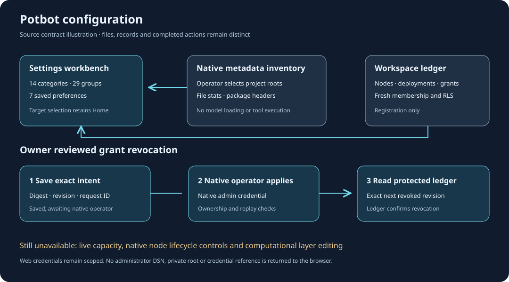
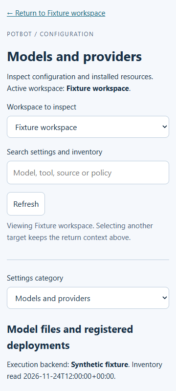
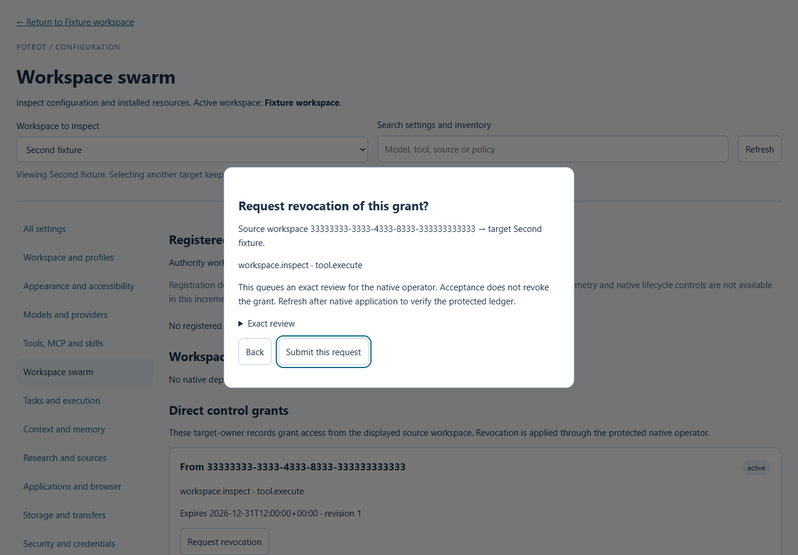

# Potbot settings inventories and swarm management

Potbot now has a `/settings` workbench with fourteen categories, a searchable
catalogue covering twenty-nine feature groups, seven saved user preferences,
local model and Python tool metadata, and workspace swarm records. The first
management workflow records an owner's reviewed grant revocation request and
hands it to the protected native operator for application.



*Source contract illustration, not an interface screenshot. A file observation,
a registered deployment, a saved request and a confirmed ledger change are
separate kinds of evidence.*

## Open the settings workbench

Use **Menu → All settings**, **Local model inventory**, **Local tool inventory**
or **Workspace swarm**. The workspace selector inspects only connections already
authorised in the Next server's `POTBOT_UI_WORKSPACES_JSON` allowlist. Each entry
has its own backend bearer credential. The original workspace remains the return
destination when inspecting another target.

Appearance supports theme, graph display, reduced motion, graph diagnostics, orb
auto-hide, download notifications and the Xpra client frame limit. Saves use the
existing revisioned preferences API. A conflict retains the draft and offers an
explicit rebase that preserves unrelated concurrent changes. Saved preferences
are consumed when the workspace reloads them; dock coordinates and compact
density remain browser-local.



*The production build at 360 pixels wide using synthetic inventory records.*

The ten existing computational settings show installation defaults and, where
available, the latest recorded run snapshot. Private credential references and
source locations appear as counts. This increment does not reconstruct a live
five-layer configuration or enable computational setting writes. Feature cards
link to the existing context, research, operation, credential and tool owners.

## Configure native inventory roots

The native operator selects project-relative roots in a private JSON profile.
The profile belongs to exactly one workspace. Model roots must be beneath that
project's `models/` directory, which remains excluded from Git and releases.

```json
{
  "schema": "potbot-local-inventory/v1",
  "workspace_id": "11111111-1111-4111-8111-111111111111",
  "project_root": "/absolute/path/to/Potbot",
  "node_label": "Local operator host",
  "model_roots": ["models"],
  "tool_roots": [".venv/lib/python3.12/site-packages"]
}
```

On Windows, the Python package root is usually `.venv/Lib/site-packages`. Keep
this profile outside public source. Add `--inventory-profile /path/to/profile.json`
to the existing `potbot serve` invocation, retaining its current database,
identity and native operator arguments. The managed service installer does not
yet persist this option. Inspect either inventory without starting a server:

```console
potbot remote-workspace inventory --profile /path/to/profile.json --workspace-id 11111111-1111-4111-8111-111111111111 --kind tools
```

Each refresh examines at most 2,000 directory entries and 100 observations, for
up to two seconds. Model traversal stops after four nested directory levels;
tool inspection reads only immediate `.dist-info/METADATA` headers. It follows
no symlinks or Windows reparse points, imports no packages, executes no tools,
reads no model weights, and makes no outbound requests. Unsupported formats and
non-Python tool installation formats remain outside this initial detector.

Observed files, partial downloads, unconfigured roots, unavailable roots and
truncated reads have distinct states. Deployment registrations and tool release
records remain separately labelled. They do not prove local installation,
current health or permission for a task. The model qualification and health
fields retain recorded registry evidence; a refresh performs no runtime probe.

## Review workspace swarm records

The swarm view reads registered node identity, pinned SSH fingerprints, the
current native deployment, direct control grants and the current principal's
management requests. PostgreSQL membership checks and row-level security apply
on every transaction. Registration establishes neither authenticated contact nor
remote qualification. Capacity, worker telemetry, node installation, drain,
restart and deletion controls remain unavailable.

An owner with the existing operator setup capability can select **Request
revocation**, review the exact grant revision and digest, then submit. The web
API appends an idempotent intent to `command_results`; its database role still
cannot change the remote authority tables. The server-only setup capability is
never included in browser responses and is omitted from passive reads.

The protected operator reviews the request and runs the command shown in its
handoff, using the existing native administrative credential:

```console
potbot remote-workspace apply-revocation --workspace-id TARGET_UUID --owner-principal-id OWNER_UUID --request-id REQUEST_UUID --confirm
```

Native application verifies ownership, the original request hash, grant digest,
revision and revocation generation. It appends exactly the next revoked grant
revision through the existing authority. Replaying the same request returns the
same result. A changed grant requires a fresh review. Refreshing the swarm view
reports completion only when the protected grant ledger agrees; a completion
claim in the application journal is insufficient. Grant revocation alone does
not establish shutdown of a running process.



*The production build showing a test grant and a keyboard-focused submit button.*

The Next bridge retains Potbot's existing loopback operator access boundary and
same-origin mutation checks. This is not a new multi-user authentication system.
Only fixed routes and bounded, allowlisted projections reach the browser;
database administrator credentials never enter this web workflow.

## Interfaces and verification

| Next resource | Native API | Method |
| --- | --- | --- |
| `/api/ui/settings/catalogue` | `/v1/ui/settings/catalogue` | GET |
| `/api/ui/settings/effective` | `/v1/ui/settings/effective` | GET |
| `/api/ui/settings/models` | `/v1/ui/inventory/models` | GET |
| `/api/ui/settings/tools` | `/v1/ui/inventory/tools` | GET |
| `/api/ui/settings/swarm` | `/v1/ui/swarm/nodes` | GET |
| `/api/ui/settings/requests` | `/v1/ui/swarm/revocations` | POST |

The dedicated [configuration acceptance workflow](../../.github/workflows/configuration-ui.yml)
uses disposable PostgreSQL to verify real membership and authority isolation,
immutable replay, changed grants, forged completion and private field filtering.
It exports actual SQL-backed HTTP responses for the TypeScript contract tests,
then runs the frontend suite, type checking and production build. Unit fixtures
remain explicitly separate from actual installed-host or model qualification.

On 24 November 2026, the Windows development checkout passed 73 focused Python
tests, 13 settings frontend tests and all 393 frontend regression tests, plus
Ruff, mypy, TypeScript and the production build. Its native inventory command
observed 45 Python distribution metadata records and one unavailable model root;
it performed no inference or remote provisioning.

The joined preview passed desktop and mobile rendering, keyboard navigation,
dialog cancellation and immediate reopening in Edge. The accessibility tree
exposes the named dialog and the controls. Cancel returns focus to the grant
action with no request. An explicit submit queues one request for the selected
workspace. Clearing and repopulating the status text keeps its live region
mounted throughout the operation. The screenshots show the observed flow.

Subsequent increments cover live layer editing, richer inventory detectors and
qualified native node lifecycle actions.
