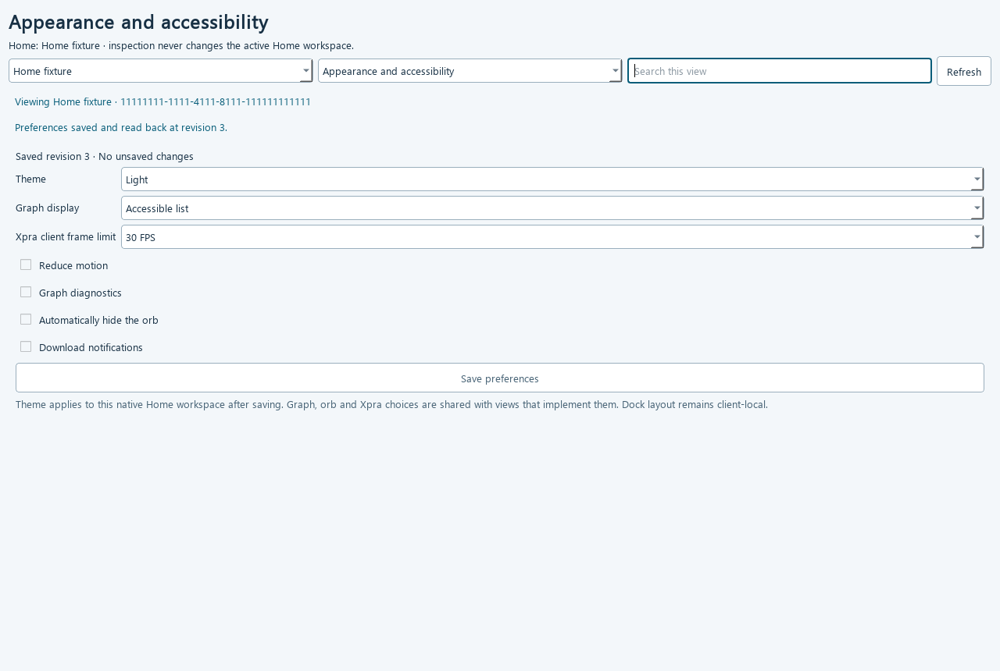
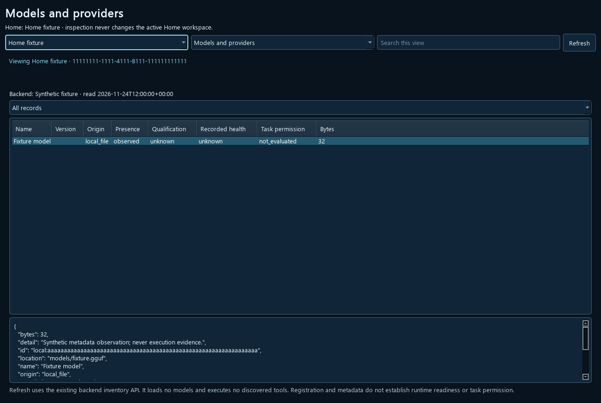

# Native Python settings and workspace swarm controls

Potbot's Python desktop now opens real Qt panels for **Settings**, **Preferences**,
**Models**, **Tools** and **Workspace swarm**. These panels call the existing
authenticated backend APIs directly. They require neither Next.js nor an embedded
browser, and they remain usable while Xpra or the web interface is unavailable.

## Use the native settings panels

Start Potbot through the existing native desktop entry point. Select **Settings**
in the left navigation for all fourteen categories and twenty-nine feature groups,
or select a specific inventory or Preferences. The ten computational settings show
installation defaults and the latest recorded snapshot. Their live layer editor
remains unavailable under the existing API contract.

Preferences edits all seven current appearance options. Saves use the existing
revisioned API. A concurrent change retains the draft and offers **Rebase my draft
for review** or **Use latest saved values**. Rebase changes only the fields edited
locally, preserving unrelated saved choices. A failed or uncertain save requires a
fresh read before another save. Saved Home theme changes apply to the native
window; graph, orb and Xpra options are shared with views that implement them.

*Actual offscreen Qt 6.12 capture on Windows, 24 November 2026, at 1280×860.
The automated interaction uses explicitly synthetic workspace and API records.
This shows the implemented widget, not a production installation or remote node.*

## Inspect model and tool inventories

Models and Tools display searchable native tables with separate columns for
presence, qualification, recorded health and task permission. Select a record for
its bounded observation details. Filters distinguish observed local metadata from
registry records and entries needing checks.

*Actual Qt fixture capture. The model file entry is synthetic; no model was loaded
and the capture establishes no inference or remote execution qualification.*

Inventory uses the existing `/v1/ui/inventory/models` and
`/v1/ui/inventory/tools` APIs. The GUI runs no scanner, discovered executable or
package import. The native backend operator must configure its existing
`potbot serve --inventory-profile` option to observe selected project-local model
and Python package roots. Unconfigured, inaccessible and partial inventories are
shown explicitly. See the [inventory profile guide](cfg01-settings-inventory-and-swarm.md#configure-native-inventory-roots).

## Manage workspace control grants

Workspace swarm has native tabs for nodes, deployments, direct control grants
and management requests. Registered nodes remain distinct from authenticated
contact and runtime qualification. Live capacity and node drain, restart,
installation and deletion actions remain unavailable because those backend
capabilities are not implemented.

Select a grant and choose **Review revocation request**. The dialog shows the exact
target, owner, grant digest, revision, generation and retained request ID. Cancel
is the default. Explicit submission queues the existing owner/setup-gated intent;
it does not revoke the grant. A private immutable review is saved before the POST,
so a lost reply or application restart can recover the original identity without
automatically sending it again.

In Requests, **Copy native operator command** copies the existing protected CLI
handoff. The GUI never executes that command or opens an administrator database
connection. After the operator applies it, Refresh derives the applied state from
the protected grant ledger through the existing API. Revocation does not by
itself establish that a running process stopped.

## Connections and native credential custody

The default connection comes from the existing service configuration and its
selected native vault profile. Optional entries in the existing
`POTBOT_UI_WORKSPACES_JSON` allowlist provide up to twelve independently scoped
loopback connections. Selecting a target inspects it while retaining Home context.
Tokens, credential references, native roots and upstream error bodies are never
rendered as widget data. The setup token is retrieved only for an explicitly
submitted management request and is omitted from passive reads and preference
saves.

HTTP and vault operations run in a two-worker Qt pool. Selection generations
discard late responses, and a changed authorization clears the displayed private
view. The transport disables environment proxies and redirects, accepts fixed API
paths only and bounds response bytes. Private review files under
`.potbot/desktop/revocations/` are recovery records, not authorization or execution
receipts. They are excluded from packages and Git.

## Verification and remaining acceptance

The [native acceptance workflow](../../.github/workflows/native-settings.yml)
requires actual Qt tests on Windows and Linux, with the locked desktop runtime
installed and no skipped native cases. It also exercises Qt interactions through
the existing HTTP handlers against disposable PostgreSQL: preference saves and
conflict rebase, actual metadata inventory, owner review, pending intent, separate
protected native application and independent ledger readback. CI retains JUnit,
bounded HTTP exchange receipts and labelled fixture captures.

On Windows the combined focused run passed 82 cases, including all 30 desktop,
client and Qt interaction cases plus the existing source-inventory and settings
API regressions. Ruff and mypy passed for the native modules. The new source
modules retain the existing entrypoint owner in Potbot's maintained source
inventory; source presence does not imply runtime qualification.

Captures use Qt's offscreen platform with an existing OS font loaded into the
isolated test application. No browser fallback, user desktop capture, production
credential change, model download or real-node mutation occurs. A live operator
window recording, manual screen-reader acceptance and installed-host qualification
remain separate. No video is claimed from still captures; the current offscreen
test surface has not been qualified with a maintained window recorder.
