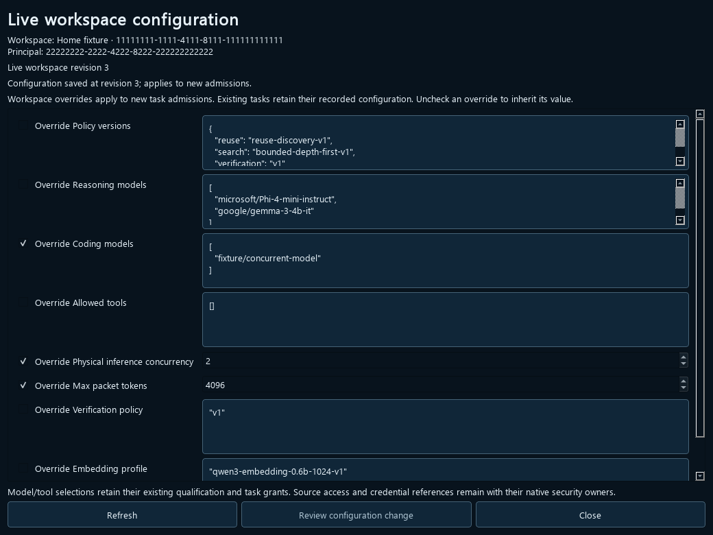
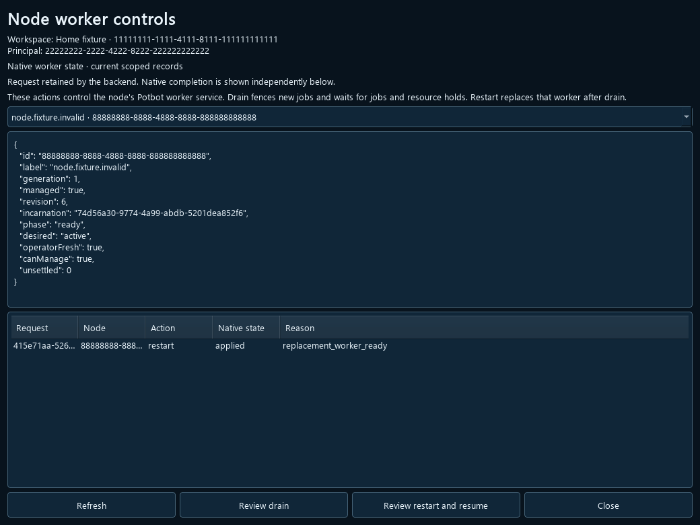

# Live configuration and native node worker controls

The Python GUI now edits live workspace configuration and queues reviewed drain
and restart requests for supervised Potbot workers. The existing settings,
inventory, grants and authentication APIs remain in place. This increment adds
supplemental live APIs and migration 59 to the existing PostgreSQL ledger.

## Edit workspace configuration

In **Settings**, choose **Live workspace configuration…**. Eight fields can be
overridden: policy versions, reasoning models, coding models, allowed tools,
physical inference concurrency, maximum packet tokens, verification policy and
embedding profile. Enable an override, edit its value and choose **Review
configuration change**. The review pins the workspace, owner, request ID, prior
revision and content hash. Cancel is the default.



*Actual Windows offscreen Qt 6.12 capture, 24 November 2026. Workspace and API
records are explicit fixtures. The concurrent coding-model selection was retained
while rebasing another change. This is an implemented widget, not an installed
production-host qualification.*

Saves create immutable workspace override revisions. New task admissions read the
latest committed overrides; existing tasks retain their recorded configurations.
Installation and deployment values still precede workspace values; repository
and task layers still take precedence over them. Clearing an override restores
inheritance. Policy maps merge keys using the existing resolver. The live editor
shows workspace values; a task's final snapshot also includes its higher layers.

A concurrent save returns a conflict. **Rebase my draft for review** preserves
unrelated remote edits and explicit removals, then requires another review.
**Use latest saved values** discards the local draft. Uncertain replies require
refresh and recovery of the original retained request, with no automatic resend.

Source-access grants and credential references retain their native security
owners. This API cannot set secrets, arbitrary paths, executable commands or
endpoints. Selecting a model or tool does not install it, grant a task permission
or qualify a runtime. Appearance preferences retain their separate shared API.

## Supervise a registered worker on its node

Run the native supervisor on the already registered node host, with its existing
workspace owner, restricted application DSN, administrator DSN and native setup
capability. Resolve credentials through the existing native vault profile or
approved environment configuration; do not put credentials in command arguments.
The registration's hostname must match the actual host.

```console
potbot remote-workspace supervise-node --workspace-id WORKSPACE_UUID \
  --owner-principal-id OWNER_UUID --node-id NODE_UUID --generation 1 \
  --provider-policy /operator/reviewed-hosted-policy.json \
  --credential-profile NODE_PROFILE --confirm
```

The example uses POSIX continuation syntax. In PowerShell, put the arguments on
one line. Use the actual registered generation and reviewed native provider-policy
file. The CLI starts the existing `potbot.api.jobs_cli worker` with a fresh managed
worker identity. It pins the policy content and waits for the worker's existing
startup frame. The GUI receives neither administrator DSN nor worker launch paths.

The supervisor must remain running. It writes protected runtime state and fresh
heartbeats. A registered node without this supervisor displays **unmanaged**;
stale, starting, draining or indeterminate workers cannot accept another control
review. A prior uncertain supervisor requires independent native reconciliation;
starting another supervisor cannot silently adopt its process or replay work.

## Drain, restart and inspect completion

Open **Workspace swarm → Node drain and restart…**. Select a supervised node and
choose **Review drain** or **Review restart and resume**. Review the exact node,
registration generation, runtime revision and incarnation before submitting.
Requests require the authenticated workspace owner and the separate setup token.



*Actual offscreen Qt widget with synthetic API records. The applied row illustrates
the independently read native receipt. Real SQL and owned-process acceptance is
required by the workflow below; this image alone is not proof of a real restart.*

The API first returns **requested**. The native supervisor authenticates the exact
review and records **accepted** while fencing admissions. Drain waits for linked
jobs, outstanding or indeterminate budget reservations and active atomic resource
holds. Existing work may finish. An expired lease remains indeterminate and blocks
completion; expiry is never presented as a successful drain.

Drain leaves the idle worker running with admissions disabled. Restart first
drains, persists its replacement marker, confirms that the old owned process has
exited, starts one replacement with a fresh incarnation and confirms readiness.
Only then does the protected event ledger report **applied**. Failed or uncertain
exit/startup produces **indeterminate** and fences further action. These controls
manage the Potbot worker service; they do not reboot a host or replace a Syn identity.

The native GUI refreshes pending receipts. A lost POST reply retains the same
review ID in its private journal. Refresh recovers its server state; any retry
requires another explicit review of that original request. Changing workspace or
authorization invalidates the dialog and discards late responses.

## API and verification boundary

| Route | Behavior |
| --- | --- |
| `GET /v1/ui/settings/live` | Scoped safe workspace overrides, revision, hash and effective workspace settings |
| `PUT /v1/ui/settings/live` | Owner/setup-gated compare and swap; immutable revision and idempotent receipt |
| `GET /v1/ui/swarm/control` | Protected worker state, unsettled count and this principal's request receipts |
| `POST /v1/ui/swarm/control` | Owner/setup-gated exact drain/restart intent; returns 202 requested |

Reads omit setup credentials and return private/no-store responses. Mutation
bodies reject duplicate JSON keys, nonfinite numbers, unsupported fields and
excess bytes. A MAC binds node intents to the native setup authority; a writable
application journal row cannot authorize a restart. RLS denies application writes
to native runtime facts and completion events. Database claim guards preserve
drain fencing even when a caller bypasses the Python claim helper.

The [live-controls acceptance workflow](../../.github/workflows/live-controls.yml)
requires real Windows/Linux Qt interaction and real disposable PostgreSQL/RLS
tests without skips. It covers configuration conflicts and task snapshot
immutability, active-job and hold draining, forged records, lease uncertainty,
replacement failure, actual existing-worker startup/restart with an empty queue,
and Qt review → HTTP handlers → SQL → owned process → protected readback. It
retains JUnit, native screenshots and bounded HTTP/process receipts.

These fixtures establish the implementation's tested behavior. Installed-host,
remote transport, model inference, screen-reader and live operator-window
acceptance remain separate. Captures come from the actual offscreen widget. No
video is claimed: the offscreen test surface has no qualified maintained window
recorder. A live operator-window recording remains the publication next action.
