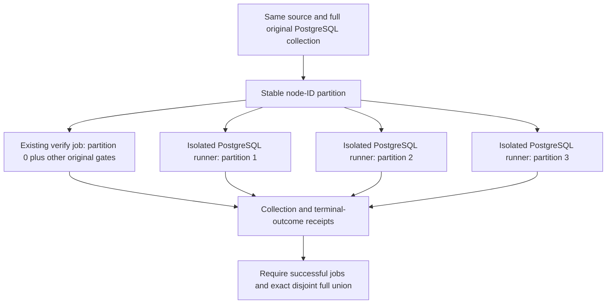

# Complete PostgreSQL test coverage in isolated CI partitions

The [PR94 verification run](https://github.com/Synsphere/Potbot/actions/runs/45298121057)
passed unit and clean-wheel checks, then reached roughly 84% of the growing
PostgreSQL lane before its 30-minute subprocess deadline. Its retained output
showed passing progress rather than an assertion failure before timeout.

CI now configures four deterministic partitions of the **same original selector**:
`postgres and not sandbox`. Each hosted runner owns its own disposable Docker
database. Individual application fixtures still create fresh databases, roles
and migrations through the existing harness; they do not share mutable fixture
state between runners or use the operator's persistent server.

*Generated configuration diagram. It explains the implemented orchestration;
new CI completion and elapsed-time improvement require actual run evidence.*

The existing `verify` check name and its unit, wheel, sandbox, migration,
accounting and acceptance gates remain. Three additional runners execute the
other PostgreSQL partitions using the same locked environment and sanitized
`scripts/check.py` owner. Exact-source T01 evidence producers also run explicitly
in the primary job, so their acceptance artifacts do not depend on which
partition owns a producer test.

`--postgres-shard 0/4` opts into a zero-based partition. The original local
`scripts/check.py --with-postgres --with-sandbox` still runs the complete lane.
Its bounded full-lane deadline is now one hour; CI partitions keep a 30-minute
subprocess bound. `--postgres-shard-only` is reserved for an explicitly selected
PostgreSQL partition and refuses incompatible flags. It does not silently disable
the default application's other checks.

The explicit pytest plugin runs after the original marker selection, hashes
each complete node ID and records the full collection identity before executing
its assigned subset. A receipt starts incomplete. Completion additionally
records pytest's exit status and exactly one terminal outcome per selected test.

The `postgres-coverage` job requires successful execution jobs and verifies:

- The exact expected GitHub source commit and unchanged selector.
- Matching full-collection counts and digests, and every unique partition index.
- Correct deterministic assignment, no overlap, and a union equal to the full
  collection in both count and digest.
- Successful pytest completion and one terminal result for every selected item.
  Skips are counted separately from passed tests.

Missing partitions, changed collections, foreign source revisions, failed or
aborted runs, collection-only runs and reused receipts cannot establish a green
coverage gate. This checks CI accounting, not cryptographic runner attestation
or production qualification; `runtime_qualified` remains false.

Unit tests exercise receipt rejection and actual isolated child-pytest processes,
including an early stop that returns exit code zero. JSON receipts, sanitized
logs and JUnit reports supply the evidence surface. This configuration change
has no native UI to capture; a screenshot or video would add no execution proof.

## Follow-up failures exposed by the complete lane

The first actual partition run reached its terminal results in 742 seconds:
195 tests passed and the tool-inventory integration case failed. Its full Git
tree contained 34,381,932 bytes, exceeding the unchanged 32 MiB repository
snapshot bound. That fixture now explicitly excludes only the generated
`docs/implementation/roadmap-inventory.json` projection through the existing
immutable snapshot profile. All Python tool sources and the original Cog,
PostgreSQL, receipt and API assertions remain. The profile and excluded path
are checked; production capture still refuses oversized snapshots.

Separately, headed first-frame acceptance sometimes timed out after a document
reported visible/focused. The synthetic test harness now additionally requires
its uniquely named native X11 window to be mapped and viewable, using bounded
read-only `xwininfo` queries. The existing pinned browser and real-pixel checks
then run unchanged. This readiness condition is a tested diagnostic/repair;
actual rendered CI must establish whether it resolves the cold-start failure.
It neither captures a warm-up image nor changes focus, the worker's six-second
deadline, capture ownership, cancellation fence, fallback rules or command set.
The existing diagram describes partition orchestration; native readiness is
retained as JSON/JUnit state rather than a screenshot of an unverified outcome.
