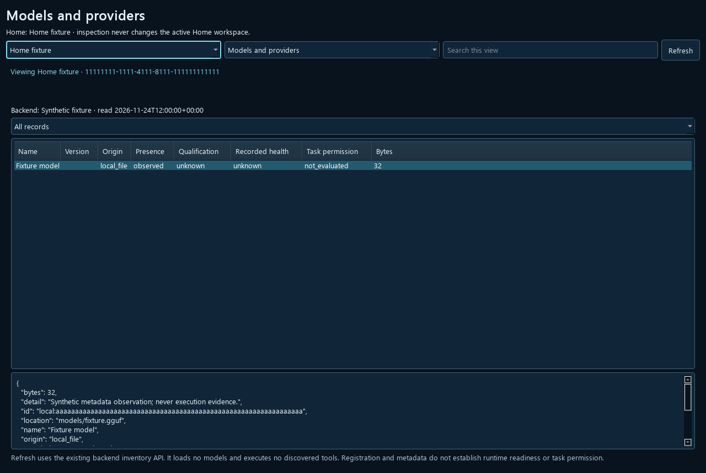

# Native desktop implementation

Potbot now has two intentional user interfaces:

- **Native local Qt 6 client** — the default local surface on Windows, macOS and
  graphical Linux. It renders before service provisioning starts and monitors
  backend, managed WSL, Xpra and the remote web interface independently.
- **Next.js web client** — retained for remote/browser access. Set
  `POTBOT_LOCAL_UI=web` to keep browser-first startup. Headless Linux defaults
  to web mode automatically.

M1 established persistent workspace chrome, startup status and an application
area. CFG02 now adds native settings, all seven saved preferences, local model and
Python tool inventories, workspace swarm inspection and reviewed grant-revocation
requests through the existing backend APIs. CFG03 extends it with live workspace
configuration and native worker drain/restart controls backed by protected SQL
state and a node-host supervisor. See the
[live-controls guide](cfg03-live-configuration-and-node-controls.md). Chat, graph
and Xpra application panes retain their next milestones.

*Actual offscreen Qt fixture capture with synthetic records; no inference or real
node qualification is established. See the [native settings guide](cfg02-native-python-settings.md)
for actions, credential boundaries and actual acceptance.*

## Startup contract

The local process creates and shows `QMainWindow` before starting the existing
one-click provisioning path in a daemon thread. The workspace therefore exists
while PostgreSQL, WSL, the Syn parent keystore, operator, Xpra and Next.js come
online. Xpra being offline or reporting zero application windows is a status,
never a reason to replace the workspace with an error view.

## Credential hardening included in M1

Managed Windows WSL no longer makes Potbot's own `CredentialStore` depend on
D-Bus Secret Service readiness. Potbot calls the authenticated parent-keystore
RPC directly. The `org.freedesktop.secrets` façade remains available for
third-party Linux applications that require GNOME/Secret Service compatibility,
but it is no longer an authority or a dependency of Potbot itself.

The Windows custody handoff also stops the retired
`potbot-syn-operator.service` after quiescing the old scheduled task, preventing
a stale WSL operator from intermittently calling a dead custody transport.

## Next milestones

1. Move native chat/session history and reasoning graph views into Qt.
2. Add native application inventory and launch controls.
3. Reuse the qualified Xpra protocol path for native application panes.
4. Extend native model/download acquisition and tool/operator setup beyond the implemented inventories and preferences.
5. Keep API/view-model contracts shared with Next.js so remote and native clients
   cannot silently diverge.
