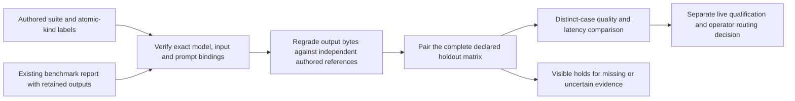

# R7.3-A: paired atomic-role benchmark evidence

Implemented on 24 November 2026, extending the existing opt-in model benchmark
runner. This increment compares retained results. It does not run inference,
install a model, grant execution, change routing or qualify a deployment.



*Generated contract diagram. It illustrates the implemented offline analysis;
it is not evidence of live model performance or an installed worker run.*

Use the existing `scripts/benchmark_agentic_models.py run` command with an
operator-reviewed suite and model configuration. Each suite case must declare
`context.atomic_kind` using one of the existing 41 `ATOMIC_KINDS`. Use
`--store-text` only when private retention of the exact generated answers is
approved. The comparison cannot independently regrade hash-only answers.
Keep the existing paid-call, disclosure and private-output controls.

```sh
python scripts/benchmark_agentic_models.py compare-atomic \
  --suite private/atomic-suite.json --models private/models.json \
  --results private/run/report.json --baseline approved-baseline \
  --candidate selected-specialist --variants generic,model_role --repeat 3 \
  --output private/atomic-comparison.json
```

The variant and repeat arguments must match the retained run. The command reads
bounded local files and exclusively creates a private report; it never constructs
an inference transport or overwrites an existing report.

## Evidence rules

- Verify suite, target, revision, input, prompt, output and rubric identities.
  Altered scores, duplicate attempts, undeclared cases and unexpected matrix
  entries are refused. Model aliases cannot pose as independent targets.
- Recompute correctness from retained output bytes. Authored reference labels
  are the oracle; a model's own evaluation does not supply correctness.
- Compare the full declared holdout matrix per atomic kind, role and prompt
  variant. Missing and indeterminate attempts remain explicit and block readiness.
- Count distinct task inputs. Repeated trials do not increase independent sample
  size; duplicate inputs across development and holdout splits are refused.
  A case passes only if all its declared trials pass.
- Report paired accuracy differences with a conservative 95% Hoeffding interval,
  median and nearest-rank p95 latency, and separately observed tokens/billing.
  Unknown usage stays unknown. The interval assumes independent task samples;
  independently reviewed dataset quality remains essential.
- Keep structural-only grading and unknown model revisions out of comparison
  readiness. Report every uncovered atomic kind; partial coverage stays partial.

Default readiness requires 12 distinct, completely paired objective holdouts.
This is readiness to inspect the comparison, not permission to deploy a route.
The report always retains `qualified: false` and zero automatic routing changes.
It validates internal consistency, not the authenticity of a provider's reported
model revision or the truth of supplied reference labels.

## Qualification and next work

Offline tests exercise output tampering, missing and uncertain results, repeated
trials, input leakage, matrix changes and CLI no-network/no-overwrite behavior.
Synthetic observations test the protocol; they are not model benchmark results.

[R7.3-B](r7-3-b-reference-baselines.md) adds source-pinned pure reference
algorithms and an integrity audit for public synthetic fixtures. Independent
gold review and protected holdouts remain open. Remaining R7.3 work includes
reviewed task datasets across the atomic taxonomy; actual tool/worker baselines;
real small/strong model runs;
exact host, backend, quantization and licence records; measured RAM/VRAM; and
independent reviewer calibration with A/B inversion. R7.4 promotion remains a
separate controller-owned gate. Existing Syn, PostgreSQL and worker authorities
are unchanged. No database migration or runtime activation is needed here.

The existing benchmark HTML comparison remains the visual inspection surface.
No new screenshot or video is included because this increment introduces a CLI
analysis contract and has no verified live model run to demonstrate. The diagram
explains the data flow without inventing performance evidence.
