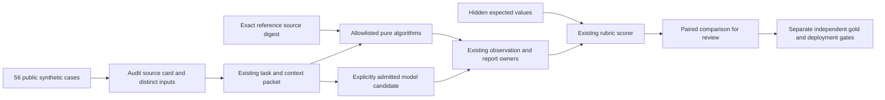

# R7.3-B: reproducible atomic reference baselines

Implemented on 24 November 2026. This extends the existing opt-in benchmark
runner and [paired analysis](r7-3-a-paired-atomic-benchmarks.md). Four pure
reference algorithms now use the same model-visible packets, prompt identities,
rubric scoring, private attempt journal and report format as model candidates.



*Generated contract illustration. Expected values enter the scorer separately;
they are absent from both the reference and candidate request packets.*

## Run the offline reference

```sh
python scripts/benchmark_agentic_models.py pin-reference \
  --output private/reference-models.json
python scripts/benchmark_agentic_models.py preflight \
  --suite examples/agentic-benchmark/atomic-reference-suite.json \
  --dataset-card examples/agentic-benchmark/atomic-reference-card.json \
  --models private/reference-models.json
python scripts/benchmark_agentic_models.py run \
  --suite examples/agentic-benchmark/atomic-reference-suite.json \
  --dataset-card examples/agentic-benchmark/atomic-reference-card.json \
  --models private/reference-models.json --output-dir private/reference-runs \
  --store-text
```

The default matrix has **168 attempts**: 56 cases and three prompt variants.
Preflight separates deterministic attempts, loopback requests and hosted calls.
Pure references need no prompt-disclosure flag because no inference endpoint
receives the packet. Every actual model call retains the existing disclosure,
paid-call policy and finite-budget requirements. Reports are exclusively created,
never overwritten; the runner retains dispatch and terminal journal records.

`pin-reference` captures the normalized reference source SHA-256. A stale pin,
arbitrary module, extra provider/URL or unsupported role is refused. The
deterministic backend accepts no shell command, file read, network request or
plugin supplied by a suite. File paths and URLs inside a hash task are literal
UTF-8 text. Unsupported cases stay indeterminate, with no fabricated timing,
tokens, cost or failure score.

| Atomic kind | Fixed reference contract |
|---|---|
| `parse_json` | JSON syntax and top-level kind; reject duplicate object keys and nonstandard NaN/Infinity constants. Large exponents remain syntactically valid numbers. |
| `extract_field` | Exact top-level key, including missing versus explicit null. Dots and slashes remain literal characters. |
| `check_hash` | SHA-256 of UTF-8 text against a lowercase digest; no external lookup. |
| `check_exit_status` | Classify the supplied process receipt. Lost reply, timeout or missing exit status remains indeterminate; it cannot establish the external effect. |

These are benchmark reference functions, not registered executable Cogs. They
receive structured inputs; their timings measure those functions rather than
model tokenization, sandbox transport or end-to-end task latency. Different
prompt variants deliberately produce the same reference answer. Provider charges
are zero, token counts are not applicable and stay null, and RAM/VRAM peaks stay
unknown. Reports include Python, OS, architecture and the reference code digest.
References are excluded from model-route recommendations.

## Dataset integrity and review boundary

The source-pinned card labels the supplied cases as **public synthetic fixtures**
with **independent review pending**. Each covered kind has two development and
twelve nominal holdout cases. Published holdout labels are not secret; distinct
inputs do not establish independent samples or a representative distribution.
Repeated exit codes and string variations test contracts, not empirical skill.
No strong/small model accuracy claim follows from passing these examples.

`audit-atomic-suite --suite ... --dataset-card ... --output private/audit.json`
checks the exact suite digest, provenance fields, existing atomic kinds,
substantive references and repeated inputs, including reworded reference inputs
across splits. It reports all **37 uncovered kinds**. A card cannot authenticate a
reviewer, upgrade these fixtures to reviewed gold or label them a protected
holdout. The audit and execution report retain `qualified: false`; automatic
routing changes remain zero. The separate receipt-verified deployment benchmark
manifest and ledger retain their existing responsibilities.

The acceptance tests exercise all literal fixtures through the actual transport
adapter and CLI, change hidden labels to prove output separation, reject stale
pins and leaked/ambiguous inputs, and check private report/journal readback.
CI is configured to retain the offline reference report and its integrity audit.
No database
migration, installed service change or Syn rollout is required.

[R7.3-C](r7-3-c-reviewer-calibration.md) adds frozen reviewer suites and paired
A/B calibration through the existing runner. Independent gold review,
independently collected protected holdouts, real selected small/strong
deployments with exact runtime, licence and quantization identities, measured
RAM/VRAM and actual reviewer quality remain open. R7.4 retains its separate
promotion decision.

The existing generated HTML report is the visual result surface. This CLI
increment adds no native interface or live model deployment to film; no screenshot
or video is claimed. The diagram explains the implemented paths without
presenting synthetic fixture correctness as deployment evidence.
