# R7.3-C: frozen peer-review suites and paired calibration

This increment extends [R7.3-A](r7-3-a-paired-atomic-benchmarks.md) and
[R7.3-B](r7-3-b-reference-baselines.md) through the same benchmark runner.
It measures whether a reviewer can select the reference-correct answer in both
positions. It does not authenticate gold labels, execute a new provider call,
qualify an installed deployment or promote a route.

```mermaid
flowchart LR
    R[Retained source report and exact suite] --> V[Existing observation verifier]
    V --> P[One predeclared source cell per task]
    P --> F[Freeze anonymous A/B and reversed B/A tasks]
    F --> A[Refuse declared self-review before dispatch]
    A --> B[Existing opt-in benchmark runner]
    B --> J[Retained reviewer responses]
    F --> C[Reconstruct exact frozen tasks]
    J --> C
    C --> M[Pair quality, wrong approvals and position bias]
    M --> G[Separate gold, deployment and promotion gates]
```



*Generated protocol illustration. Only the separately admitted runner can make
model calls; suite construction and calibration are offline operations.*

## Freeze, run, then calibrate

```sh
python scripts/benchmark_agentic_models.py build-review-suite \
  --suite private/source-suite.json --models private/source-models.json \
  --results private/source-run/report.json --first selected-small \
  --second selected-strong --source-variant generic --source-trial 1 \
  --variants generic,family,model_role --repeat 1 \
  --output-dir private/frozen-review

python scripts/benchmark_agentic_models.py preflight \
  --suite private/frozen-review/review-suite.json \
  --review-bundle private/frozen-review/review-bundle.json \
  --models private/reviewer-models.json

python scripts/benchmark_agentic_models.py run \
  --suite private/frozen-review/review-suite.json \
  --review-bundle private/frozen-review/review-bundle.json \
  --models private/reviewer-models.json --confirm-prompt-disclosure \
  --output-dir private/reviewer-runs --store-text

python scripts/benchmark_agentic_models.py calibrate-reviewers \
  --review-bundle private/frozen-review/review-bundle.json \
  --models private/reviewer-models.json --results private/reviewer-run/report.json \
  --variants generic,family,model_role --repeat 1 \
  --output private/reviewer-calibration.json
```

Use the actual run directory reported by `run`. Reviewer targets select
`roles: ["judge"]`. The example run requires separately configured loopback
models. Hosted reviewers additionally require the existing provider policy,
paid-call opt-in and finite call/cost caps. Freezing local files grants no
disclosure or execution authority. Preserve private output controls and the
actual model/runtime records required by the R7 plan.

The builder verifies source identities and regrades retained outputs. It uses
the **same declared prompt variant and trial for every source task**, rather
than finding a favorable trial after looking at outcomes. Only objective
holdout pass/fail pairs qualify for this diagnostic suite. Development cases,
structural-only references, missing/uncertain source attempts, equal outcomes
and oversized packets have explicit exclusion reasons. At most 100 source
tasks produce 200 orientation cases; larger eligible sets are refused rather
than silently truncated. No answer is shortened.

The private bundle binds the original suite/report/targets, source inputs,
literal answer bytes, reference outcomes and both orientations. Its exported
suite omits source target identities and gold labels from model-visible packets.
Candidate prose can still reveal its author; this is transport-level blinding,
not proof that answer text contains no identifying clues. SHA-256 consistency
does not authenticate a bundle's author or source labels.

Preflight and run reconstruct the exact frozen suite and refuse declared
self-review, including another target ID, endpoint or backend with the same
model/revision. The older derived-judge convenience mode also excludes those
aliases. These checks compare declared identities; independently authenticating
the provider and its actual weights remains a deployment gate. A reviewed run
retains the bundle digest for later calibration.

## Read the measurements correctly

| Synthetic protocol example | Result from 12 source tasks |
|---|---|
| Always choose A in both orientations | 24 valid verdicts; 12 wrong-answer approvals; 12 position-inconsistent tasks; zero symmetrically correct tasks. |
| Choose the reference-correct answer in both orientations | 24 valid verdicts; 12 symmetrically correct tasks. This is a test fixture, not a measured model result. |
| Lose one response from the otherwise correct fixture | 11 complete tasks; missing evidence remains visible and readiness is withheld. |

Calibration reuses the observation verifier for model/revision, input, prompt,
output hash, stored score, matrix and duplicate checks. Verdicts additionally
require exactly `{"choice":"A"}` or `{"choice":"B"}`. Duplicate keys, extra
fields, Markdown and malformed choices are not valid approvals.

Report wrong-answer approvals and first-position choice rates over the
**observed valid verdicts**, with missing, indeterminate and malformed counts
beside them. Symmetric accuracy and its Wilson lower bound use only complete
valid source tasks; every declared repeat and both orientations must pass for
one task to pass. Repeats and order inversions do not increase the sample count.
These are conditional diagnostics when evidence is incomplete, not estimates
of full-cohort success.

Default comparison readiness needs 12 distinct complete source tasks, exact
declared revisions and no missing, uncertain or malformed verdicts. Readiness
permits inspection of this comparison only. Gold authentication, independent
task sampling, real deployment qualification, measured RAM/VRAM and the R7.4
promotion decision remain separate. All reports retain `qualified: false` and
zero automatic routing changes. No database migration, installed service or
Syn transport change is required.

Unit and CLI fixtures demonstrate both orientations, fixed source-cell choice,
source exclusions, private exports, alias refusal before transport construction,
receipt tampering, repeated-sample limits and incomplete/malformed outcomes.
No live reviewer performance is claimed. The table and diagram explain the
protocol; a native UI screenshot or video would not demonstrate an additional
implemented interface, so neither is supplied for this CLI increment.
