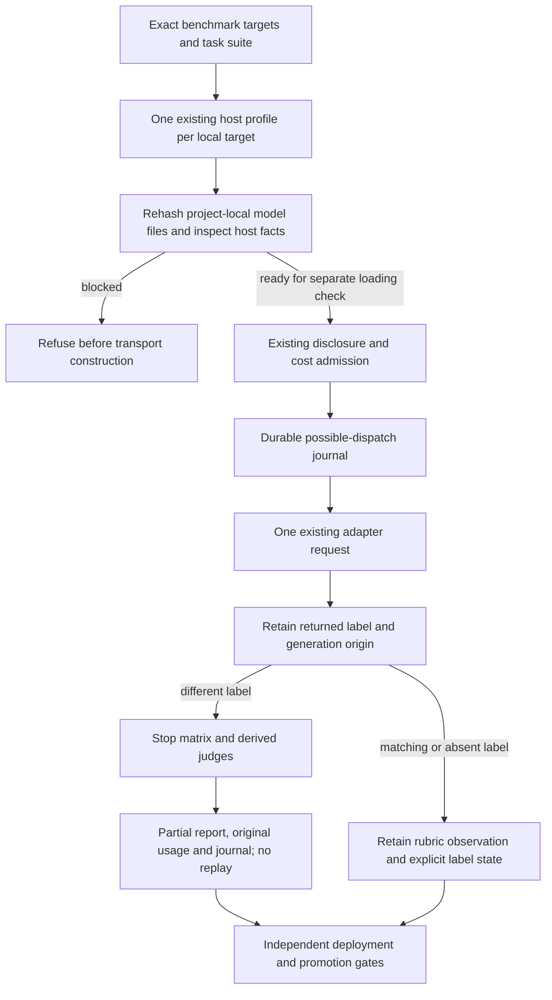

# R7.3-D: exact deployment declarations and returned model labels

This source increment connects the existing opt-in benchmark runner to
`LocalHostProfile`, `DeploymentSpec` and their offline preflight owner. It also
retains the model label returned by an adapter, which earlier observations
dropped. These records support inspection; actual server loading, installed
worker qualification, independent gold and routing promotion retain their gates.



*Generated contract illustration. A ready offline inventory and a matching
response label do not authenticate the process serving the model.*

## Bind an explicitly configured local deployment

The optional `--deployment-bindings` document uses schema
`potbot.benchmark-deployment-bindings/1` and a `bindings` array. Each item has
exactly `model_id` and `host_profile`; the latter is the existing complete
`LocalHostProfile` document. Bind every configured `loopback_openai` target
exactly once. Hosted and deterministic targets do not borrow local profiles.

```sh
python scripts/benchmark_agentic_models.py preflight \
  --models private/exact-models.json --suite private/reviewed-suite.json \
  --deployment-bindings private/deployment-bindings.json --project-root .

python scripts/benchmark_agentic_models.py run \
  --models private/exact-models.json --suite private/reviewed-suite.json \
  --deployment-bindings private/deployment-bindings.json --project-root . \
  --confirm-prompt-disclosure --output-dir private/benchmarks --store-text
```

Target model and immutable revision must match the profile. Output-token limits
and required reasoning/coding roles must fit its deployment. The original
preflight checks exact weights, tokenizer, configuration and template bytes
under the owning project's `models/`, backend package/version and explicit
resource facts. Duplicate JSON keys, incomplete bindings, changed bytes and
incompatible targets are refused. No weights are downloaded or loaded.

Preflight exports sanitized blockers and returns a nonzero status when blocked.
Run refuses a blocked binding before creating a transport or vault resolver.
Both flags are required together; ordinary unbound runs remain available and
explicitly report `unbound`. Binding files grant no prompt disclosure, provider
account, paid-call or execution authority.

The report retains host/deployment fingerprints, exact declared deployment
metadata, immutable model revision and the original preflight report, including
observation origin. Fixture or operator-supplied facts keep their origin labels.
Files on the caller's disk cannot prove that an independent loopback server
loaded them, honored the template or used a declared quantization. Licence
acceptance, peak RAM/VRAM and server-loaded identity require separate evidence.

## Preserve an unexpected completion without attributing it to the target

| Returned label | Retained result |
|---|---|
| Exact configured model string | `matched`; a provider/server declaration, with no weights authentication. |
| No label | `unknown`; the rubric observation remains available, with identity explicitly unreported. |
| Different string | `identity_mismatch`; no score is attributed to the requested model. |

No alias or provider snapshot is silently treated as equivalent. Configure an
exact target after independent review if a legitimate label differs.

A mismatch stops subsequent primary requests and derived judging. The private
partial report and original terminal journal retain output hash, optional text,
returned label, origin, elapsed time, tokens and observed charge. Existing paid
admission reservations remain held. Unattempted primary cells are counted, the
CLI returns failure after saving the report, and no request is replayed.
Unknown usage remains unknown; a mismatched call can still have a known charge.

New reports hash the complete declared target configuration, including endpoint
and token settings. Offline paired/reviewer analysis checks that hash when
present, checks returned-label classification, and excludes mismatched rows
from quality pairs. Historical reports without these additive fields remain
explicitly unreported. Their declarations do not gain authentication.

The existing HTML comparison displays execution status and returned-label
comparison. Unit/CLI fixtures exercise file drift before dispatch, strict JSON,
endpoint drift, partial report persistence, retained costs and stopping before a
reverse judge request. The diagram and table explain this evidence contract;
there is no new native interface or live model demonstration to capture.

## Compatibility and remaining work

This adds no database migration, scheduler, production RPC route or persistent
service. Existing sandbox, Syn and credential owners retain their authority.
Rollback selects the previous benchmark source and preserves historical private
reports; uncertain calls still require reconciliation rather than rerunning.

Continue R7.3 with independently reviewed protected datasets, measured actual
server/worker deployments and role-specific quality/resource comparisons. R7.4
policy/shadow promotion must consume those separately qualified results. This
increment and its protocol fixtures retain `qualified: false` and zero automatic
routing changes.
