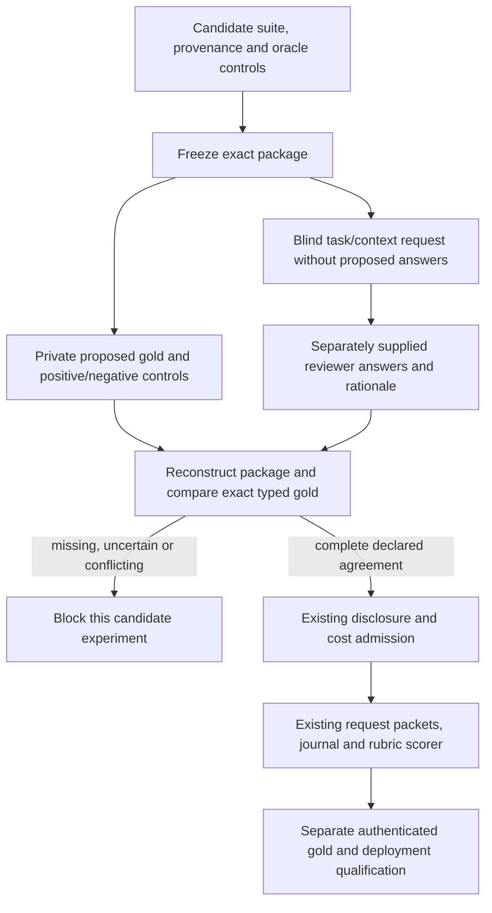

# R7.3-E: frozen candidate datasets and blind gold review

This increment prepares operator-supplied candidate data for review through the
existing opt-in benchmark runner. It separates proposed gold and oracle controls
from a blind review request, detects conflicting answers and binds the retained
review audit to an experiment. No actual private dataset or independent human
review is supplied by these protocol fixtures.



*Generated protocol illustration. Declared agreement establishes internal
consistency; reviewer identity, secrecy and model quality retain separate gates.*

## Prepare a candidate package

```sh
python scripts/benchmark_agentic_models.py prepare-atomic-dataset \
  --suite private/candidate-suite.json --provenance private/provenance.json \
  --controls private/oracle-controls.json --output-dir private/frozen-dataset

python scripts/benchmark_agentic_models.py audit-atomic-gold-review \
  --candidate-package private/frozen-dataset/candidate-package.json \
  --gold-review private/reviewer-answers.json --output private/gold-review-audit.json
```

The suite uses the existing `RoleSuite` format. Provenance has exactly
`author_id`, `licence`, `source` and `exposure: "declared_private_candidate"`.
These are bounded declarations; the tool does not fetch, license or download a
dataset. Public fixture cards retain their original unreviewed public format.

Controls use schema `potbot.atomic-oracle-controls/1` and a `cases` array with
exactly one record per suite case. Each record contains `case_id`, one
`positive_response` string and one to four distinct `negative_responses`.
The existing rubric must accept the positive response and reject every negative
response and an empty response. Structural-only graders, duplicate cases,
unknown atomic kinds and repeated inputs across development/holdout splits are
refused. Rewording a structured reference input does not make it independent.
These checks test the oracle contract, not the truth of its authored labels.

The new directory is created exclusively. `candidate-package.json` retains the
complete suite, proposed answers, controls, provenance and exact input manifest.
`review-request.json` contains case IDs, role/task/context and the response
contract, with an input-manifest digest. Proposed labels, per-case gold hashes,
controls, author identity and split membership are absent from that request.
No request is sent to another person or service by preparation or auditing.

Inspect task/context content before sharing a review request: deliberately
embedded answers cannot be made secret by removing an `expected` field.
File permissions and field separation do not attest a recipient's isolation.
Keep the package with the controller; provide only the reviewed input request
to a separately authorized reviewer through the existing disclosure policy.

## Supply independent answers, then inspect agreement

The reviewer supplies schema `potbot.atomic-gold-review/1`, the exact
`input_manifest_sha256`, a distinct declared `reviewer_id`, a bounded `source`
reference and an `answers` array. Each answer has `case_id`, `verdict`, `expected`
and `rationale`. A `resolved` answer supplies its own expected value using the
case's response contract. An `uncertain` answer has `expected: null` and retains
its rationale. IDs matching the declared author, including case-only aliases,
are refused. This cannot detect a person using another unverified identity.

| Audit result | Meaning for this optional candidate workflow |
|---|---|
| `pending_review` | Cases are missing or uncertain; candidate dispatch is blocked. |
| `conflicting_gold` | At least one independently supplied value differs; dispatch is blocked. |
| `declared_agreement` | Every case has a resolved, exactly matching typed answer; the experiment may proceed through its existing admission checks. |

The audit keeps missing, uncertain and conflicting IDs separate. It includes
exact package/suite/input/review hashes, coverage and uncovered atomic kinds,
without copying proposed answers or reviewer rationale into the summary.
It never resolves disagreement by voting, accepts only favorable cases, changes
a frozen label or silently drops an unresolved row.

```sh
python scripts/benchmark_agentic_models.py preflight \
  --models private/exact-models.json --suite private/candidate-suite.json \
  --candidate-package private/frozen-dataset/candidate-package.json \
  --gold-review private/reviewer-answers.json

python scripts/benchmark_agentic_models.py run \
  --models private/exact-models.json --suite private/candidate-suite.json \
  --candidate-package private/frozen-dataset/candidate-package.json \
  --gold-review private/reviewer-answers.json --confirm-prompt-disclosure \
  --output-dir private/benchmarks --store-text
```

Preflight saves no changes and reports incomplete/conflicting review with a
nonzero exit status. Run refuses it before transport or vault construction.
The suite must exactly match its frozen package. Reviewer files without their
package, and mixing public fixture cards with this private candidate format,
are rejected. New metadata uses bounded strict JSON, including duplicate-key
and non-finite-value rejection. Exports never overwrite existing files.

The existing model packet is unchanged: task/context enter inference, while
proposed gold, oracle controls, provenance and reviewer rationale remain with
the scorer. Reports retain the review audit. Provider disclosure, paid-call
limits, returned-model checks and durable no-replay journals still apply.

`independently_reviewed`, `reviewer_identity_authenticated`, `secret_holdout` and
`qualified` remain false, with zero automatic routing changes. Authenticated
independent review, actual access isolation, distribution quality, live
small/strong-model and peer-reviewer measurements, and measured deployment
resources are the remaining R7.3 gates before R7.4 promotion.

There is no database migration, new scheduler, installed-service change or Syn
authority change. Rollback selects the preceding runner; retain existing
packages, reports and uncertain attempts without replay. Tests cover blind
exports, oracle controls, split leakage, exact reconstruction, typed conflicts,
private/exclusive files and admission before a transport exists. The diagram
and state table describe the implemented CLI workflow; no live reviewer or
native UI demonstration is claimed.
