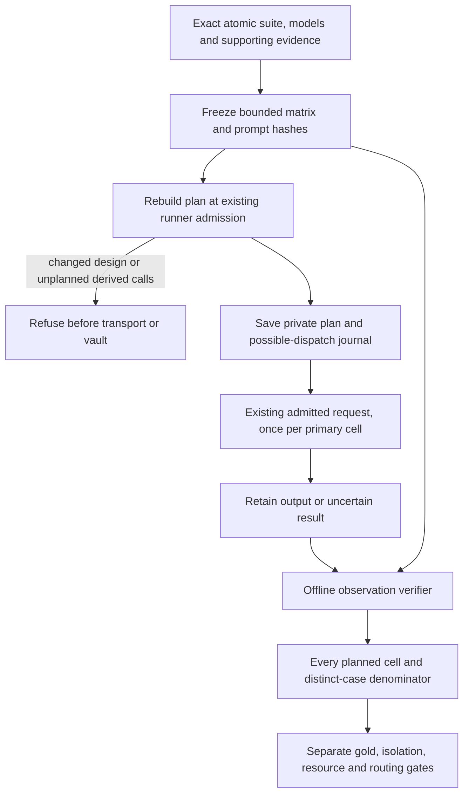

# R7.3-F: freeze an experiment and account for its whole cohort

This increment binds the existing opt-in atomic benchmark to a predeclared
suite, target configuration, compiled prompts, repeats, shuffle seed and
supporting evidence. The runner saves that exact plan before its first possible
dispatch. An offline audit regrades the retained outputs and accounts for every
planned cell, including outcomes that are unavailable.



*Generated protocol illustration. A hash binds contents; it does not authenticate
when the author originally designed an experiment or which weights were served.*

## Freeze, execute and inspect

```sh
python scripts/benchmark_agentic_models.py prepare-experiment \
  --suite private/candidate-suite.json --models private/exact-models.json \
  --candidate-package private/frozen-dataset/candidate-package.json \
  --gold-review private/reviewer-answers.json --variants generic,family,model_role \
  --repeat 2 --shuffle-seed 42 --output private/experiment-plan.json

python scripts/benchmark_agentic_models.py preflight \
  --suite private/candidate-suite.json --models private/exact-models.json \
  --candidate-package private/frozen-dataset/candidate-package.json \
  --gold-review private/reviewer-answers.json --variants generic,family,model_role \
  --repeat 2 --shuffle-seed 42 --experiment-plan private/experiment-plan.json

python scripts/benchmark_agentic_models.py run \
  --suite private/candidate-suite.json --models private/exact-models.json \
  --candidate-package private/frozen-dataset/candidate-package.json \
  --gold-review private/reviewer-answers.json --variants generic,family,model_role \
  --repeat 2 --shuffle-seed 42 --experiment-plan private/experiment-plan.json \
  --confirm-prompt-disclosure --store-text --output-dir private/experiments

python scripts/benchmark_agentic_models.py audit-experiment \
  --suite private/candidate-suite.json --models private/exact-models.json \
  --candidate-package private/frozen-dataset/candidate-package.json \
  --gold-review private/reviewer-answers.json --experiment-plan private/experiment-plan.json \
  --results private/experiments/RUN_ID/report.json --output private/experiment-audit.json
```

Use the run ID returned by the existing runner. Supply the same optional dataset
card, candidate package, review, deployment bindings and reviewer bundle at each
stage that consumes them. Preparation hashes those documents; it neither admits
their truth nor substitutes for their existing run-time checks. When deployment
bindings are used, preflight/run also require their owning `--project-root`.
Freeze only after reviewing the final intended design and supporting inputs.

Every case must have an eligible target and every target must have a case.
Unknown atomic kinds, repeated task inputs (including reworded structured
reference inputs), repeated variants, invalid repeats/seeds and matrices above
1,600 primary cells are refused. Freeze performs no model calls. It contains
hashes and identifiers, not literal gold, rationale, task text or endpoint URLs;
treat even metadata as private. Exports use exclusive creation and never replace
an existing plan or audit.

Preflight rebuilds the plan without constructing a transport or vault. Run
checks it before creating its run directory, then rechecks at existing execution
admission. A changed model endpoint, output limit, case, prompt, evidence file,
variant, repeat or seed requires a new explicitly prepared plan. Existing
unbound runs remain available. A plan grants no disclosure, paid API, policy,
keystore or execution permission; original admission controls remain in force.

Bound runs require explicit `--store-text` so later auditing can regrade literal
responses. They reject `--judge-derived`, whose outcome-dependent requests are
outside the frozen matrix. Prepare and freeze a separate R7.3-C reviewer suite
instead. The actual plan is saved beside `run.json` and the durable attempt
journal before possible dispatch; the run and result retain its digest.

## Account for all outcomes

| Planned-cell outcome | Retained interpretation |
|---|---|
| Completed, rubric passes | Completed evidence with independently recomputed rubric match. |
| Completed, rubric fails | Completed evidence and a failed-rubric count. |
| Reply unavailable | Indeterminate, with unknown completion and accounting; no replay. |
| Returned model differs | Identity mismatch, with original observed cost retained. |
| No retained result | Missing; the planned denominator remains unchanged. |

The audit reuses R7.3-A's observation verifier for exact model, input, prompt,
trial, status, output hash and rubric checks. Duplicate, unexpected, forged-score
or hash-only completed records are refused, rather than selectively discarded.
The report must carry this exact plan and target configuration digest.

Cohorts separate atomic kind, role, development/holdout split, model and prompt
variant. All declared repeats must have completed and passed for one distinct
case to count as verified. `verified_pass_fraction_of_planned_cases` divides
those verified cases by every planned case in that cohort: it is a retained
evidence fraction, not an estimate that missing replies were incorrect or an
independent quality qualification. Repeats do not add independent cases.

`complete_for_analysis` means all planned cells have completed, attributable,
regradable results; it can be true with failed rubrics, public fixtures or weak
graders. It supplies neither a correctness floor nor routing authority. Reports
also list all uncovered atomic kinds. Known billed charges form an explicitly
observed subtotal; the total stays unknown if any planned cell has unknown
billing. A known charge from a model-mismatch completion is still included.

Preparation and audit use bounded JSON. Plans and reports accept finite
statistical fractions while rejecting duplicate keys, non-finite numbers,
invalid UTF-8, excess depth/node counts and files above 16 MiB. Supporting
candidate/deployment metadata keeps its existing stricter bounds. Keep runs
small enough for these retained evidence limits; the tool never truncates them.

## Remaining qualification and recovery

These are source/fixture protocols. No actual independent gold, protected-data
isolation, model-server identity, peak RAM/VRAM, live specialist quality or
historical prior-registration authority is established. Reports retain
`prior_registration_authenticated: false`, `qualified: false` and zero automatic
routing changes. R7.4 remains behind its separate acceptance gates.

Auditing never contacts a model, resumes a run or replays an uncertain attempt.
A process crash may leave only the existing attempt journal: preserve it as
uncertain evidence; this report audit does not manufacture a completed report
from a partial journal. A new run is a separately admitted experiment, not
recovery by repeating an external effect.

There is no migration, additional scheduler, installed-service change or new RPC
route. Rollback selects the preceding runner while retaining plans, reports and
journals. Unit tests demonstrate before-dispatch plan retention, changed-design
refusal, whole-cohort metrics, malformed evidence and lost-reply audit without
resending. The diagram/table explain this CLI feature; no native UI, live model
screenshot or demonstration video is claimed by these synthetic tests.
