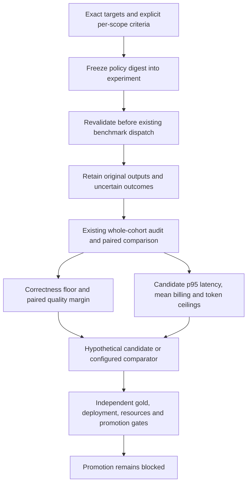

# R7.4-A: frozen offline routing shadow evaluation

This increment evaluates explicit role-specific criteria against the retained
R7.3 experiment. It performs no new inference and does not select a runtime
route. A hypothetical comparator choice is distinct from a qualified fallback,
live shadow request, canary rollout or operator-approved promotion.



*Generated contract diagram of the implemented offline flow. No production
route, deployed model or live shadow traffic is demonstrated by this figure.*

## Declare the criteria before execution

A `potbot.atomic-shadow-policy/1` document has exactly `schema` and `rules`.
Supply one rule for every planned holdout atomic-kind/role/prompt-variant scope;
missing, duplicate and unplanned scopes are refused. There are at most 64 rules.
Each names distinct eligible configured `baseline` and `candidate` targets.
Aliases for the same configured model/revision/backend/provider are refused.

One illustrative rule is shown below. Use the exact IDs in your private model
configuration and provide all scopes in your actual suite, rather than copying
this one-rule example into an unrelated experiment.

```json
{
  "schema": "potbot.atomic-shadow-policy/1",
  "rules": [{
    "atomic_kind": "check_exit_status", "role": "triage", "variant": "generic",
    "baseline": "strong", "candidate": "tiny",
    "minimum_distinct_cases": 12,
    "minimum_accuracy_lower_95_bps": 9500,
    "maximum_accuracy_drop_bps": 200,
    "maximum_p95_latency_ms": 5000,
    "maximum_mean_billed_microunits": 10000,
    "maximum_mean_total_tokens": 1024
  }]
}
```

Limits are exact integers; booleans and floating-point substitutions are refused.
A basis point is one hundredth of a percentage point: 9500 is 95%, and 200 is a
two-percentage-point allowed drop. Minimum distinct cases is 12 through 200;
repeating an input does not increase that count. A zero billing ceiling is
allowed only as an explicit criterion, and unknown billing still blocks it.
These are operator-declared experimental criteria, not universal quality floors.

```sh
python scripts/benchmark_agentic_models.py prepare-experiment \
  --suite private/suite.json --models private/models.json --variants generic \
  --shadow-policy private/shadow-policy.json --output private/plan.json

python scripts/benchmark_agentic_models.py run \
  --suite private/suite.json --models private/models.json --variants generic \
  --shadow-policy private/shadow-policy.json --experiment-plan private/plan.json \
  --output-dir private/runs --store-text --confirm-prompt-disclosure

python scripts/benchmark_agentic_models.py shadow-routing \
  --suite private/suite.json --models private/models.json \
  --shadow-policy private/shadow-policy.json --experiment-plan private/plan.json \
  --results private/runs/RUN_ID/report.json --output private/shadow-audit.json
```

Carry the same optional candidate package, gold review, dataset card, deployment
bindings and reviewer bundle at each stage. Existing disclosure, native-vault,
paid-call and cost admission remain required. Run/preflight refuse shadow criteria
without a frozen plan. The exact policy digest is retained in that plan before
possible dispatch; changing criteria afterward requires a separately admitted
experiment. An old unbound report cannot acquire this binding retrospectively.
Hashes establish consistency, not authenticated chronology or independent truth.
Legacy experiments without a policy retain their original plan contents/digest.

## Interpret the result

| Evidence or criterion | Offline result |
|---|---|
| Any planned result missing, uncertain or model-mismatched | Whole experiment remains incomplete; every rule is blocked. |
| Too few distinct paired holdouts or a structural-only grader | Paired holdout evidence is not ready. |
| Candidate Wilson lower bound below the configured floor | Correctness criterion fails. |
| Conservative paired interval crosses the allowed quality drop | Noninferiority is not established. |
| Candidate p95 exceeds its ceiling | Tail-latency criterion fails. |
| Mean observed candidate billing or total tokens exceeds its ceiling | Resource criterion fails. |
| Any candidate billing/token measurement unavailable | It remains unknown and blocks that criterion. |
| All offline criteria met | Hypothetical candidate selection only; promotion remains blocked. |

All trials of a case must pass to count that case as a success. The existing
unrounded Wilson bound and conservative paired interval are reused. P95 uses
the existing nearest-rank observed latency definition. Billing/token ceilings
compare exact sums with ceiling times completed attempts before displaying a
mean; failed completed attempts still contribute cost and timing. Only the
candidate's own ceilings are evaluated; unknown baseline billing does not prove
cost savings. Per-rule intervals do not establish simultaneous family-wide
confidence across many comparisons. Conservative bounds can leave small suites
inconclusive even when all observed answers match their rubric.

`hypothetical_selection` names the candidate when its criteria pass and the
configured comparator otherwise. The comparator has no implied qualification
or execution authority. Reports retain exact policy/plan/report digests, the
full experiment audit, each rule and all blockers, without copying task text,
gold, endpoints or output text. Files remain private and use existing exclusive
creation; a failed criterion returns CLI status 2 after retaining its audit.

## Promotion, compatibility and rollback

Every report keeps `qualified: false`, `promotion_ready: false`,
`prior_registration_authenticated: false`, zero model requests and zero automatic
routing changes. Authenticated independent gold, actual protected-holdout
isolation, server/worker identity, measured peak RAM/VRAM, licence/deployment
acceptance, a qualified rollback route, live shadow/canary evidence and operator
promotion remain separate gates. Nothing here satisfies the remaining R7.3
runtime gates or connects a route to the live scheduler.

There is no migration, network service, new scheduler or Syn RPC route. Rollback
selects the previous benchmark source while retaining all plans and uncertain
attempts; auditing never resends a request. Unit tests use clearly synthetic
retained responses and a controlled lost-reply transport. The diagram and table
explain this CLI-only feature; there is no new native interface or live-provider
video to capture, and these tests do not qualify actual model quality.
