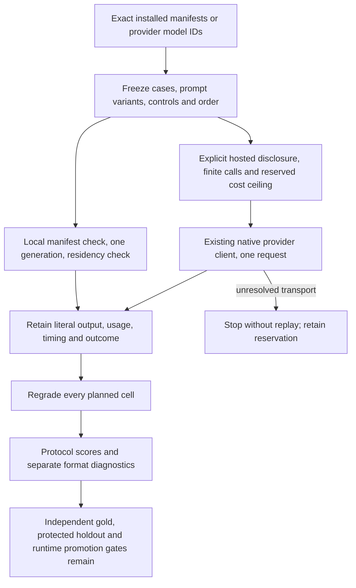
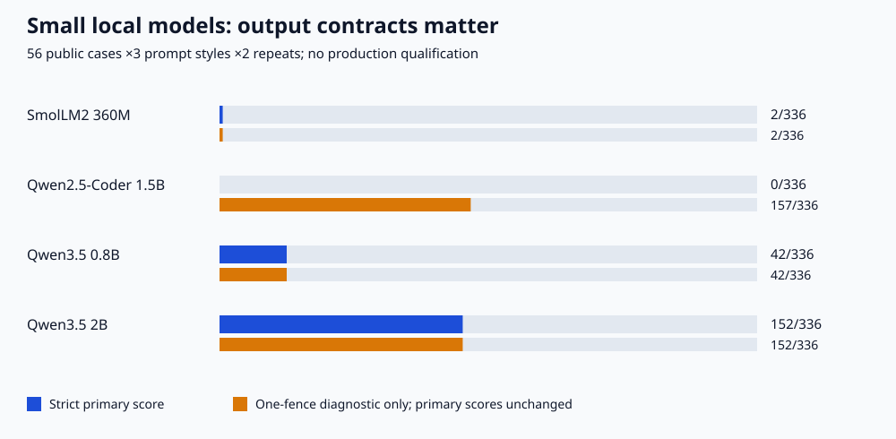

# R7.4-B: reproducible local and inexpensive hosted trials

The opt-in benchmark can compare installed Ollama packages with explicitly
selected OpenAI snapshots using the existing frozen suite, prompt compiler,
attempt journal and offline grader. This is measured protocol testing. It
does not qualify a model, activate a route or complete the R7.4 runtime rollout.



*Generated protocol diagram of implemented benchmark ownership. It does not
depict an additional production RPC service or a qualified installed worker.*

## Freeze generation settings and reduce repeated weight loading

`loopback_ollama_v1` accepts an explicit HTTP loopback `/api` endpoint and a
`sha256:<original-registry-manifest>` revision. Before requesting generation it
checks the installed manifest declaration; afterward it checks the loaded
residency declaration. A different or absent pin is refused. These server
responses are useful consistency observations, not independent weight or
hardware attestation. The original registry digest differs from Ollama's
extended local manifest file hash; do not substitute the latter.

The versioned native profile sends thinking disabled, temperature zero, seed 42,
a 4096-token context and one non-streaming request. Its output cap comes from
the frozen model target. It forces no JSON schema, supplies no hidden answer,
does no response cleanup, follows no redirects and retries nothing. Manifest,
generation and residency reads share one 90-second deadline and bounded JSON
responses. Unknown charges stay unknown rather than becoming zero electricity
or hardware cost.

`--execution-order model_blocks_v1` groups the shuffled cells by model and
randomizes model-block order using the declared seed. Each model remains loaded
while its own randomized cells run, reducing repeated disk/GPU weight loading.
There is no warm-up request outside the planned denominator. The ordering
choice and native generation profile are hashed into the plan before dispatch.
Compare first-in-block latency separately from subsequent requests. Sequential
blocks do not establish an isolated, simultaneous hardware comparison.

The default remains the original shuffled order. Legacy experiments without
these opt-ins keep their original plan shape and digest.

```json
{
  "id": "local-trial", "model": "smollm2:360m",
  "backend": "loopback_ollama_v1",
  "revision": "sha256:REPLACE_WITH_THE_ACTUAL_64_LOWERCASE_HEX_MANIFEST_DIGEST",
  "base_url": "http://127.0.0.1:11435/api",
  "roles": ["evidence", "status"], "max_output_tokens": 384, "tier": "micro"
}
```

This is an illustrative template; its placeholder is intentionally invalid.
Use the actual installed digest, not a guessed revision or a different package.

## Explicit inexpensive OpenAI configurations

The ordinary hosted backend retains its previous defaults. A revision of
`openai-cheap-v1:<exact-model-id>` explicitly opts into the small comparison
profile. Its four admitted model IDs and controls are:

| Model | Reasoning effort | Sampling control | Status observed 24 November 2026 |
|---|---|---|---|
| `gpt-5-nano-2025-08-07` | minimal | Provider default | Deprecated, retained as a low-price comparison |
| `gpt-6-luna` | none | Provider default | Current alias; no dated snapshot exposed |
| `gpt-4o-mini-2024-07-18` | Omitted | Temperature zero | Deprecated, retained as a low-price comparison |
| `gpt-5.6-luna` | none | Provider default | Current alias; no dated snapshot exposed |

See the official [pricing](https://developers.openai.com/api/docs/pricing),
[GPT-6 Luna](https://developers.openai.com/api/docs/models/gpt-6-luna),
[GPT-5.6 Luna](https://developers.openai.com/api/docs/models/gpt-5.6-luna),
[GPT-5 Nano](https://developers.openai.com/api/docs/models/gpt-5-nano) and
[GPT-4o Mini](https://developers.openai.com/api/docs/models/gpt-4o-mini) pages.
Enumerate the actual credential's catalogue before selection. A catalogue entry
does not prove generation access, protocol compatibility or quality. Aliases
and dated snapshots are labelled separately; no local weight pin is invented.

This opt-in uses the existing fixed-origin native Responses client, with
`store=false`, no tools, no forced output schema and no retry. The typed provider
request binds a supplied reasoning effort in its fingerprint and wire body;
omitting it keeps legacy request identities unchanged. Other providers cannot
acquire this control through the OpenAI protocol. The source profile and exact
controls are retained in the experiment and report.

Hosted calls still require native-vault credentials, explicit prompt disclosure,
an exact provider policy, finite call limits and a whole-matrix cost reservation.
Never put an API key in a model file, plan, job, report or shell command. Retain
the consulted price date and distinguish conservative rate-based estimates
from a verified provider invoice. Cache discounts and free local hardware are
not inferred. Unknown-cost outcomes keep their reservations held.

A known output-token limit retains its actual answer and provider usage and is
labelled `openai-cheap-v1-length`. The normal strict rubric grades the actual
text. An unresolved transport failure fences further paid cells; the report
retains their missing denominators and does not resume or replay the request.
The output cap includes provider reasoning tokens where applicable, so this
configuration is part of the comparison rather than a hidden quality adjustment.

## Actual first local trial



*Generated chart from the retained 24 November 2026 local experiment. Each model
completed 336 attempts: 56 public synthetic cases, three prompt variants and two
repeats. The primary score requires the original literal JSON response contract.
The second series removes exactly one enclosing Markdown fence as a post-hoc
diagnostic; it does not replace the primary score or qualify a route.*

| Installed package | Strict rubric matches | One-fence diagnostic matches | Median end-to-end milliseconds |
|---|---:|---:|---:|
| SmolLM2 360M F16 | 2/336 | 2/336 | 406 |
| Qwen2.5-Coder 1.5B Q4_K_M | 0/336 | 157/336 | 156 |
| Qwen3.5 0.8B Q8_0 | 42/336 | 42/336 | 359 |
| Qwen3.5 2B Q8_0 | 152/336 | 152/336 | 360 |

The whole-cohort audit found 1,344 completed attempts, no missing, uncertain or
model-mismatched observations, and 1,148 failed primary rubrics. The coder wrapped
322 replies in Markdown despite the requested literal JSON contract; 157 of
those wrapped answers matched after the explicitly secondary fence diagnostic.
No primary response or score was rewritten. Repeats are not independent cases.

This suite covers JSON parsing, exact field extraction, exit status and hash
checks. These operations already have deterministic reference implementations;
the results are not general coding, agent reasoning or production accuracy.
The nominal holdouts are public synthetic fixtures with independent gold review
still pending. All generations used the same declared output cap, while package
quantization and supported sampling controls differ. Native GPU residency is
not independently measured peak VRAM. Separate private run receipts retain
literal responses, timings, model declarations, source snapshots and full plans.

## Reproduce and interpret

Use the existing `prepare-experiment`, `preflight`, `run`, `audit-experiment` and
`compare-atomic` commands, with identical suite, card, exact models, variants,
repeat count, shuffle seed and execution order. Add the explicit grouped order
to preparation, preflight and run together; a changed order requires a new plan.
An audit never calls a model. Keep original uncertain attempts and source files.

Compare matching cases, splits and prompt variants. When comparing separate
runs, retain their original report/plan digests and label any paired projection
as derived analysis, never as a newly executed combined run. Show semantic and
format failures, known token limits, unknown outcomes, pricing assumptions and
uncovered atomic kinds. Never reinterpret criteria after seeing results.

The native/hosted transport tests include manifest drift, wrong endpoint,
redirects, oversized/malformed responses, lost replies, exact reasoning fields,
legacy fingerprints, grouped execution and retained budget holds. Synthetic
network tests establish contracts; actual model trials supply separate measured
evidence. The diagram and measured chart are relevant visuals for this CLI
feature; no new native GUI or production video acceptance is claimed.
