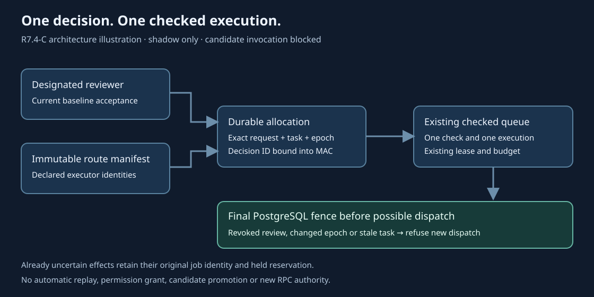
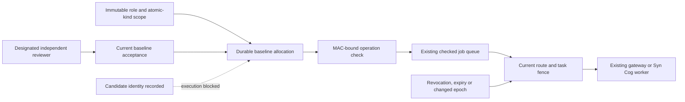

# R7.4-C: persistent shadow routing and literal JSON prompt trials

This increment persists a **baseline-only shadow decision**, binds it to the
existing operation check and execution, and fences a stale decision before
possible dispatch. The candidate is recorded for later comparison and is never
invoked by this service. Canary execution, promotion and automatic fallback to
a separately qualified route remain unfinished. Full R7.4 is not qualified.



*Architecture illustration of the implemented control path, not a screenshot or
live deployment receipt. Tests use synthetic worker reports. Screenshots and
video add no useful evidence to this database/CLI boundary; no GUI was changed.*

Follow-on: [R7.4-D checked prompt and worker-admission bindings](r7-4-d-checked-prompt-and-worker-bindings.md) now enforces an opt-in recipe, compiled-input provenance and observed worker configuration. It still does not qualify model weights, enable canaries or complete R7.4.

## One durable decision, one checked execution

`ModelRoutingService` is a controller-side service over the existing PostgreSQL
database and `OperationWorkbench`. It introduces no public RPC, scheduler,
provider credential owner, retry loop or budget ledger. Native Cog execution
continues through the existing Syn sandbox worker. Hosted work retains its
normal capability, disclosure, credential and budget checks.



Migration 50 adds three scoped tables:

| Record | What it owns | What it does not establish |
| --- | --- | --- |
| Policy | Immutable baseline/candidate executor projections, declared runtime identities, reviewer, prompt-contract and evaluation-plan digests; stage and epoch | A digest does not attest the running server or qualify a model |
| Independent review | Authenticated designated reviewer, literal verdict, evidence digest and expiry; append-only revisions | A hash alone does not prove the evidence true; the reviewer must inspect it |
| Decision | One exact request, current task contract, epoch, review, five-minute admission expiry and single check/run links | No permission to repeat an effect or release a reservation |

The role and atomic-kind fields scope the controller's policy. They do not add
an executable operation to the registered Cog catalogue. Hosted target roles
must match the route role. Native targets retain their pinned operation,
profile and typed input identity. The full request remains private to its owner.

Policies begin in `draft`. Only the designated **different PostgreSQL login's
principal**, already enrolled in this workspace, can append baseline acceptance
or revocation. An owner-supplied flag or forged `WorkspaceContext` cannot do so.
The reviewer can read the designated manifest and reviews, but receives no
private job or request access. All functions execute with the caller's existing
privileges; there is no new security-definer bypass.

The implemented lifecycle is `draft → shadow → blocked`, with explicit return
from `blocked` to `shadow` after current acceptance, or terminal `disabled`.
Every transition increments the epoch. The database rejects `canary` and
`promoted`, including direct application SQL attempts.

An allocation key is permanently tied to its original request and decision.
Looking it up after restart, expiry or lost reply returns the retained identity;
it does not renew admission. A fresh review does not revive an old decision.
The original queued job remains the authority for terminal or uncertain status.

## Fencing and accounting

The decision ID is included in both check and launch authorization MACs. Omitting
or substituting it invalidates the authorization. Legacy requests without a
routing decision retain their existing MAC identity.

The check's job insert atomically claims the decision. The execution insert
atomically claims the check/run link and repeats exact request and task-contract
checks. A common transaction-scoped policy lock orders review, allocation,
activation, admission and the existing `dispatched_at` marker. Review revocation
that commits before a waiting dispatch prevents that marker from committing.

The final fence rejects a changed epoch, superseded/revoked/expired review,
expired decision, stopped route or changed task contract. It does not cancel an
already marked possible effect or manufacture its result. In-flight work keeps
the original job identity and held/indeterminate reservations. There is no
automatic model switch or replay after lost output.

## A new prompt hypothesis, without changing old scores

The [completed public-fixture comparison](r7-4-b-local-and-cheap-hosted-trials.md)
showed frequent Markdown wrapping from the tiny coder. That suggests a prompt
contract experiment; it does not justify silently repairing primary responses.

The compiler now accepts an explicit `output_contract="json_object_v1"` for its
existing structured-output roles. It reiterates literal object boundaries,
exact role fields, no Markdown/prose, duplicate keys or nonfinite values. The
prose synthesizer refuses this option. Task/evidence bytes and advisory native
protocol metadata remain unchanged. This is textual instruction, not native
constrained decoding or proof that a model will comply.

```python
from potbot.models.prompt_compiler import compile_reasoning_prompt
from potbot.evaluation.prompt_contracts import evaluate_json_object_v1

packet = compile_reasoning_prompt(
    model="operator-selected-model",
    role="investigator",
    task="Choose evidence queries from the supplied registered tools.",
    output_contract="json_object_v1",
)
# Compilation performs no inference. Dispatch remains the normal checked job.
shape = evaluate_json_object_v1('{"queries": []}')
assert shape["syntax_valid"]
assert shape["semantic_correctness"] == "not_evaluated"
```

Opting in creates prompt version `model-aware-reasoning-json-object-v1` and a new
content identity. Omitting the option preserves all legacy prompt bytes and
identities. Existing frozen benchmark CLI plans do not silently select this
profile. A future live trial must explicitly freeze these new prompt bytes and
its semantic rubric before execution; tuning on the prior public cases is
development reuse, not new protected holdout evidence.

`evaluate_json_object_v1` is an offline syntax metric for **new trials**. It
checks literal, bounded JSON and refuses fences, trailing text, duplicate keys,
NaN/Infinity, exponent overflow and excessive depth/size. It neither repairs text
nor evaluates role schema or semantic correctness. Even `{"wrong_answer":true}`
passes syntax. Original primary scores and the separately labelled post-hoc
one-fence diagnostic are unchanged. No additional model calls or API spend were
made to implement this increment, and prompt effectiveness remains unmeasured.

## Verification and remaining gates

`tests/integration/test_model_routing_postgres.py` exercises genuine restricted
PostgreSQL logins, same-workspace reviewer separation, cross-workspace refusal,
restart/idempotence, concurrent single-check admission, MAC/request binding,
stale epochs, revocation/reacceptance, actual database-clock expiry, a revocation
transaction racing dispatch, and retained indeterminate jobs/reservations.
The normal operation-workbench and atomic-graph suites cover compatibility.
These are synthetic worker receipts, not live model qualification.

For Linux qualification use the repository's disposable loopback PostgreSQL
fixture with pgvector 0.8.7. Do not point the destructive fixture at an operator
database. Unit prompt/benchmark regressions perform no inference or paid calls.

Still required before full R7.4 completion:

1. Authenticate and independently inspect real baseline/runtime acceptance,
   protected gold/holdout evidence and resource measurements.
2. Add bounded canary execution and independently checked outcome settlement;
   bind compiled prompt and exact running deployment proof into that admission.
3. Add explicit promotion and regression rollback to the last independently
   qualified, still-current route; retain uncertainty and single-effect semantics.
4. Qualify the installed controller through signed Syn worker packages. No live
   installation or model route was activated by these source/tests.
