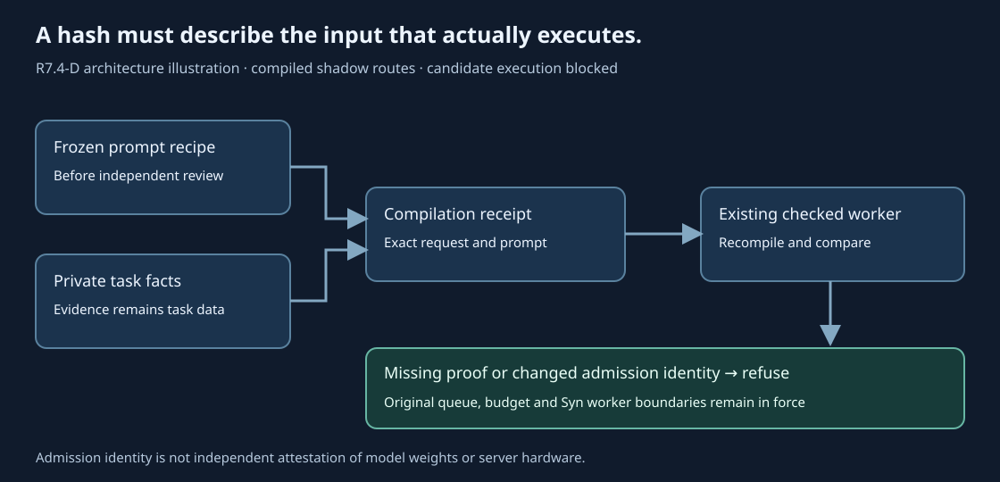
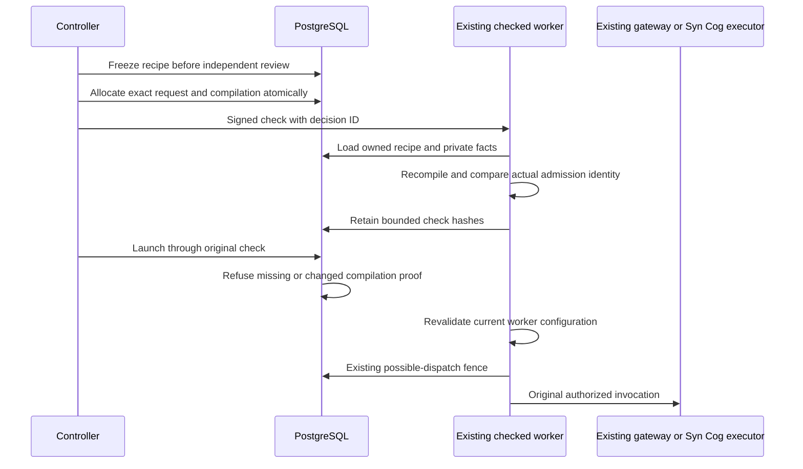

# R7.4-D: checked prompt and worker-admission bindings

Compiled shadow routes now enforce the recipe, literal prompt bytes and observed
worker configuration that their hashes describe. A changed prompt or admission
identity blocks the existing checked execution before a provider effect. This
extends [persistent shadow routing](r7-4-c-persistent-shadow-routing.md); it does
not enable candidate execution, canaries, promotion or qualified rollback.

*Architecture illustration of the implemented checks. It is not a screenshot of
a live model deployment. Database and worker tests use synthetic inputs and
mocked HTTP; no GUI was changed, so screenshots/video would not add evidence.*

## Bind executable inputs to their provenance

Migration 51 adds two append-only, scoped records without changing the previous
migrations. A prompt recipe fixes its model, reasoning role, prompt variant and
optional `json_object_v1` output contract. Its digest must equal the immutable
route manifest's prompt-contract digest. Attach it while the route is still in
its original draft epoch, **before any independent review or allocation**.
Existing shadow routes without recipes retain their historical contract; they
do not gain compiled-prompt guarantees retroactively.

The controller compiles task, evidence, constraints and context using the
existing prompt compiler. Supplied material remains data. Prompt compilation
does not infer, disclose anything to a provider or obtain permission. The
unfilled request retains its existing executor, task, token/time parameters and
native Cog identity. An already supplied prompt/system is refused instead of
being silently overwritten. Native model requests must carry an explicit model
field in their typed value; the installed Cog still has to accept that contract.

The exact request and its compilation record commit in the same allocation
transaction. The record binds recipe, private facts, literal compiled-prompt
identity, decision, review, epoch and request digest. Facts are detached from the
caller's mutable data. A lost reply can recover the same allocation and record;
it cannot replace the input or manufacture another invocation.

| Record or observation | Visibility | Meaning |
| --- | --- | --- |
| Frozen recipe | Route owner and designated independent reviewer | Reviewed configuration, not private task data |
| Task facts and compilation receipt | Owning principal only | Reproducible literal input provenance |
| Signed check/launch | Existing worker/controller boundary | Exact request and route decision authorization |
| Public check hashes | Existing value-blind report | Identity evidence without prompt/facts/credentials |

## Recompute on the configured worker

The existing `OperationChecks` path now recognizes compiled routing decisions.
It runs ordinary task, capability, credential, disclosure, sandbox, grant,
installation and budget checks. It then loads the owned compilation record,
recompiles the frozen facts, compares the literal request, and compares actual
admission observations with the accepted baseline identity. The report contains
only `modelRoutingSha256`, `modelPromptSha256` and `modelRuntimeSha256` alongside
the existing check fields. It includes no private task packet.

The execution insert and final dispatch fence require the exact recorded proof.
A fabricated eligible report without any one of these hashes cannot insert an
execution. An allocation inserted directly in SQL without its compilation
receipt cannot claim a check. The normal worker revalidates observations before
execution, so an admission-policy change after a successful check still blocks
the effect. Existing route epoch/revocation/task fences remain in force.

## What the worker identity does and does not prove

For hosted inference, the identity covers the exact executor selection and
**operator policy fingerprint**. It does not attest the provider's weights,
server hardware or a mutable model alias. For native Cogs, it covers the selected
executor plus the existing checked profile, installation, worker runtime and Syn
provenance, and tool-release identity where present. A changed native profile is
refused. These are controller/worker admission observations, not independent
hardware measurements or proof of a model server's loaded weights.

Real local inference still needs an installed, qualified model Cog and exact
model-server/deployment proof. No direct controller-to-model transport or new
RPC authority was added. Native execution remains inside the existing sandbox
worker and Syn node boundary. The native pin tests do not qualify a new installed
inference Cog.

## Verification and continuation

The PostgreSQL integration suite runs compiled requests through the normal
`OperationWorkbench`, check worker, linked launch and hosted gateway with mocked
HTTP. It verifies one invocation, existing durable budget settlement, zero
provider effects on admission change, private fact isolation, immutable receipts,
and database refusal of incomplete/fabricated proof. Native regression tests
retain the existing installed-profile/grant/pin checks using their explicit
transport fixtures. These tests are not live model or host qualification.

The unrelated CI assertion that migration 49 must be the newest revision now
selects migration 49 by version and retains all its original scope/trigger/lock
checks. New additive migrations must not invalidate a historical contract test.

Next gates remain: independently accepted real model deployment/server identity,
protected paired holdout outcomes, bounded canary accounting, explicit promotion,
regression rollback to a still-qualified route, and installed-controller
qualification with signed Syn packages. Full R7.4 remains unfinished. No model
was promoted, production database changed or paid call made for this increment.
