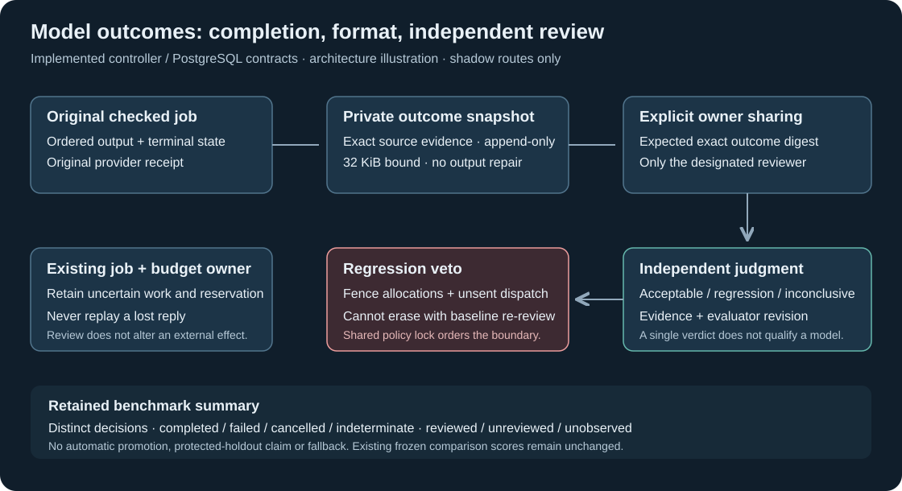
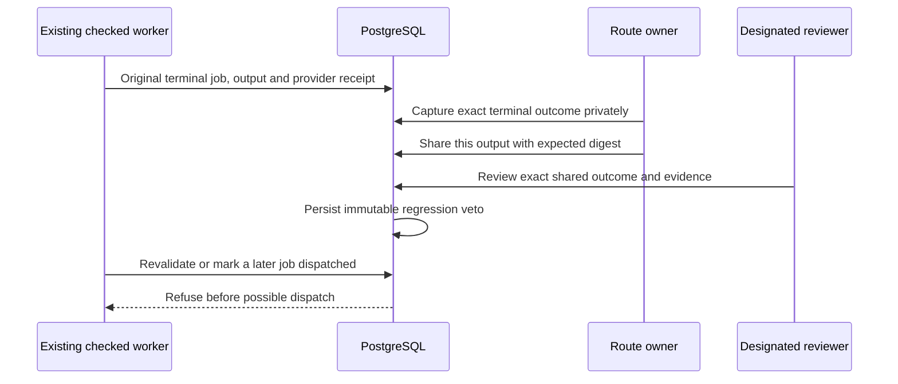

# R7.4-E: durable model outcomes and independent regression review

The checked routing path now retains the original terminal hosted job's output
and provider completion evidence. The owner can explicitly share that exact
output with its designated reviewer. An independently recorded regression fences
future allocations and unsent routed dispatches, including an already checked
job. This extends [prompt and admission bindings](r7-4-d-checked-prompt-and-worker-bindings.md).
Full R7.4 remains unqualified; candidate execution is still blocked.

*Architecture illustration of implemented source contracts, not a screenshot of
a qualified model deployment. The demonstration uses restricted PostgreSQL and
mocked provider responses. No interface changed; screenshots or video would not
add evidence of this database/controller behavior.*

## Three different questions

| Question | Evidence | What it does not establish |
| --- | --- | --- |
| Did this invocation finish? | Original job state, dispatch marker and original provider receipt | Correctness or resource qualification |
| Did it follow the literal output contract? | Existing versioned JSON evaluator, without repair | Whether its answer is true or useful |
| Was this particular answer acceptable? | Designated authenticated reviewer, exact outcome digest, evaluator revision and evidence reference | A protected holdout result, general model quality or route promotion |

The controller reconstructs output from the existing ordered `job.output`
events. Migration 52 checks this text, terminal state, timestamps, result metadata,
recipe contract and provider receipt against the original owned execution. It
does not accept a caller's replacement answer, changed job identity or fabricated
provider status. Receipts are snapshots at capture time: later reconciliation
does not rewrite an old unknown outcome as success.

The current reader supports one hosted model selected by an existing shadow
route and a maximum of 32 KiB of output. Larger output is refused rather than
truncated. Native Cog output requires a separately qualified typed artifact
reader; the controller does not guess its shape or bypass Syn to read a model
server. No new model connection, RPC transport, queue, scheduler or budget owner
is introduced.

## Sharing is a deliberate controller operation

Capture is private. `share` requires the owner's expected outcome digest and
discloses only this bounded output snapshot and its completion metadata to the
route's designated reviewer. Output can itself contain private information;
the caller must authorize its disclosure. It is not automatically shared because
an independent reviewer was named in the policy.

The reviewer receives no underlying prompt, compiled task facts, job-event access
or private hosted request. Additive restrictive policies also enforce original
job ownership on hosted requests, invocations and invocation events. Both
principals remain constrained by the normal workspace membership and restricted
database login. All added functions use invoker rights.

An outcome review is append-only and bound to one exact decision. Repeating an
identical review returns the existing verdict; a replacement verdict or reused
identity with different content is refused. A complete literal answer remains
unreviewed until that distinct principal supplies its own judgment. An
indeterminate, failed, cancelled, incomplete or malformed response cannot receive
an `acceptable` verdict through the service. The database separately refuses
an acceptable review without confirmed original completion evidence.

## A regression veto fences dispatch

An independent `regression` verdict makes the policy's baseline acceptance
unavailable. Existing allocation, admission and possible-dispatch checks use
the same transaction-scoped policy lock as review. A queued job that has not
dispatched cannot gain permission from an earlier successful check. Repeating
baseline acceptance cannot erase this outcome veto. A replacement policy needs
its own explicit qualification and review; there is no automatic fallback.

Already dispatched work remains owned by its original job and ledger. The veto
does not assert that an in-flight request stopped, undo an external effect,
release an uncertain reservation or resend a request. An eligibility veto is
reported separately from loss of the job lease so an unsent job can close as
failed instead of remaining running until lease expiry.

## Benchmark accounting and verification boundary

The bounded owner summary counts distinct route decisions, observed terminal
states, unobserved decisions and independent verdicts. Unknowns and unreviewed
answers remain visible. It does not treat repeated outputs as independent test
cases or convert this operational sample into protected holdout evidence.
The previous local/OpenAI benchmark scores and frozen experiment identities are
unchanged. No additional paid or local inference was run for this increment.

Tests use real restricted PostgreSQL principals and the existing checked worker
with explicitly mocked HTTP. They exercise private capture, explicit sharing,
literal-versus-semantic assessment, immutable review, direct SQL receipt forgery,
regression fencing after a prior successful check, final database dispatch
fencing, and reply loss without replay or release of an indeterminate budget.
These tests do not qualify live model weights, hardware or installed inference.

Next gates: real model deployment/server evidence, a native typed inference
reader within the existing Syn worker boundary, protected independently reviewed
paired holdouts, bounded canary accounting, explicit promotion and rollback to a
still-qualified baseline. The persistent route remains shadow-only.

Follow-on: [R7.4-F checked reasoning results](r7-4-f-checked-reasoning-results.md) adds a bounded native artifact reader and shared role validation. Engine installation, native outcome capture and runtime qualification remain separate.
