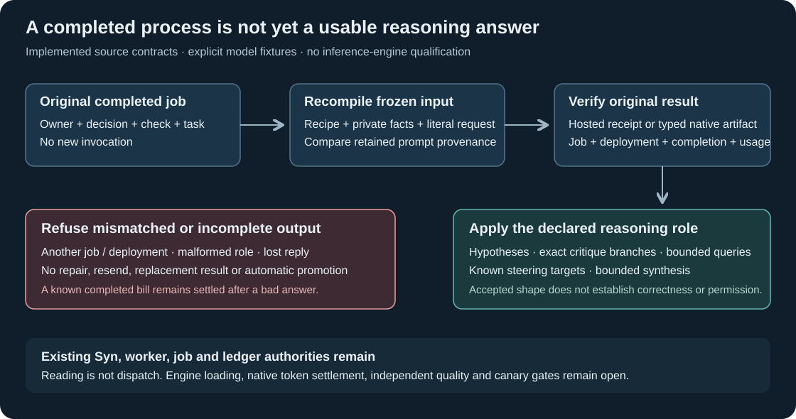

# R7.4-F: checked native results and reasoning role validation

Reasoning can now read an original completed routed job through an owner-only
result boundary. It rechecks the frozen prompt and exact job linkage, then
validates the answer's declared role. Native model results use a bounded typed
artifact bound to the invocation, literal request and registered deployment.
This extends [reviewed route outcomes](r7-4-e-reviewed-route-outcomes.md).

*Architecture illustration of source contracts, not a live model deployment.
Tests use restricted PostgreSQL and explicitly synthetic provider/native
execution. There is no new interface to screenshot or video to demonstrate.*

## Read the original effect without repeating it

`ModelRoutingService.reasoning_result` reads one owned decision. The decision
must retain its frozen recipe and compilation receipt. The reader recompiles
the private facts, compares exact prompt and request identities, and verifies
that the original completed job belongs to that decision, check, task and
contract revision. A missing, failed, cancelled or indeterminate job cannot
supply an accepted reasoning result.

For hosted inference, the original provider receipt must match the selected
provider/model/role and identify a completed, normally stopped invocation. The
reader reconstructs the retained output events and validates original reported
usage. For native inference, it reads only the artifact referenced by the
original owned job, through the existing content-addressed artifact verifier.
Oversized or non-JSON artifacts are refused before reading their contents.

Reading a retained result does not require the old route to remain active.
The route may have since been blocked or disabled; the result still describes
the old invocation. This does not grant another allocation or dispatch. Reading
performs no model request, replay, reservation, settlement or permission change.
Explicit outcome sharing with a reviewer does not grant this owner-only access
to private facts and routed results.

## Native model data contract

The request port is `syn://type/potbot-local-model-request-v1`. Its exact fields
are model, deployment digest, literal system/prompt and an output-token limit.
It accepts no endpoint, file path, executable or additional execution option.
The output port is `syn://type/potbot-local-model-result-v1`.

| Result binding | Required comparison |
| --- | --- |
| Invocation and request digest | Original job UUID and exact native input value |
| Deployment/model | Original registered immutable deployment and selected model |
| Reported provenance | Weight digest, backend/version, tokenizer revision and chat-template digest |
| Role protocol | Deployment declares the compiled reasoning-role prompt version and output adapter |
| Completion | Normal stop; process success alone is insufficient |
| Usage | Integer counts, consistent total, request output cap and deployment context cap |

Native result artifacts are at most16KiB, with at most8KiB of nonempty answer
text. Duplicate keys, Markdown envelopes, non-finite numbers, invalid Unicode,
excessive nesting, extra fields and boolean token counts are refused. A length
or cancelled completion remains representable evidence but cannot be consumed
as a completed reasoning answer.

These are **consistency checks on a worker report**. A matching weight digest is
not independently observed loading, hardware attestation or a qualified model.
The result explicitly remains runtime-unqualified. Native usage is labelled
worker-reported; this reader does not settle it or invent a token charge.

## Validate the role before using the answer

The shared validator reuses the existing hypothesis, critique and steering
parsers. It also validates investigator queries and bounded synthesis prose.
Model proposals stay data and never become authorization to execute a tool.

| Role | Representation boundary |
| --- | --- |
| Hypothesis generator | Existing bounded hypotheses/assumptions/questions contract |
| Critic | Exactly the distinct branch IDs supplied in the frozen context; scores remain advisory |
| Investigator | At most three distinct bounded queries; no command or authority fields |
| Steering evaluator | Known branch for reopening; action-specific branch/hypothesis fields |
| Synthesizer | Bounded nonempty answer, with correctness still independently unassessed |

The existing `ReasoningInvestigator` now applies the same literal/role checks
after retaining provider completion and known usage. A malformed completed
answer closes the reasoning run without retrying or marking its known charge
uncertain. Its existing steering controller retains ownership of clarification
for invalid branch proposals. The new routed reader applies strict frozen
branch/action checks because it consumes an already completed selected result.

## Verification and remaining integration

Tests run real restricted PostgreSQL, original checked jobs, capability grants,
artifact publication and recovery. Provider HTTP and native execution are
explicit fixtures. A native process fixture can finish successfully while its
reply is refused for another job/deployment or a length termination. Separate
tests confirm one settled charge after malformed reasoning output, owner-only
result access, unchanged uncertain reservations and recovery without replay.

The source does not install an inference engine, change a signed worker image,
activate a deployment or replace the legacy host-supplied reasoning callback
with a production transport. The durable independent outcome store still has
its earlier hosted-only capture boundary; this native reader does not silently
broaden that migration. No additional model calls were made for this increment.

Next: an actually installed model Cog and qualified engine/model loading through
the existing Syn worker; token reservation/settlement through the existing job
ledger; native outcome capture/review; and the production reasoning dispatch
adapter. Protected paired holdouts, bounded canaries, explicit promotion and
qualified rollback remain separate R7.4 gates. Candidate execution stays blocked.
