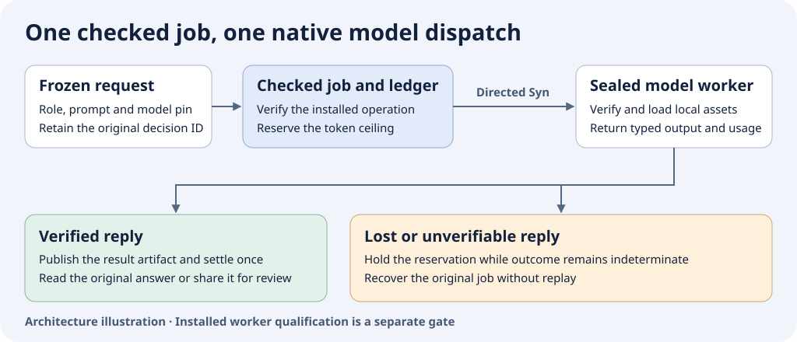

# R7.4-G native model workers and checked reasoning

Potbot can admit a pinned local model through the same checked job, Syn worker and PostgreSQL budget path used for other installed Cogs. The controller gives the worker one typed inference request. A valid worker reply supplies the output and reported token counts. The controller can recover the original job without sending the request again. This extends [checked reasoning results](r7-4-f-checked-reasoning-results.md) and [reviewed route outcomes](r7-4-e-reviewed-route-outcomes.md).

*Architecture illustration of the controller and worker boundaries. This increment adds a service path with no new user interface. The diagram shows behavior exercised by fixtures. Screenshots and video would offer little additional evidence of token settlement or recovery.*

## Pin the installation

- The sandbox image build accepts `POTBOT_NATIVE_INFERENCE=1`. This opt-in installs the CPU-only `llama-cpp-python` 0.3.19 backend. The default build omits the engine, and enabling the build option alone grants no operation.
- An administrator-owned `potbot.hosted-native-cog/3` profile admits the image-pinned `/usr/local/libexec/potbot-local-model` entrypoint with the native request and result ports. The operation's `model_deployment` contains the exact registered deployment document and the built `libllama.so` digest. The image, entrypoint, repository state, Agent, Syn provenance and Cog grant still use the normal installation checks.
- Store the single-file GGUF and its Jinja chat template as immutable content-addressed files under the existing read-only shared model library. The guest resolves each asset under `/opt/potbot/models/blobs/<first two digest characters>/<digest>` and verifies its bytes. The tokenizer revision is the weights digest because the tokenizer comes from the same GGUF. No model weights belong in the rootfs or in source control.
- The worker exchanges only work input and completion over the existing directed Syn Context route. The literal request supplies a model, deployment digest, system text, prompt and output-token cap. The installed operation supplies the executable and engine. Prompts have no authority to select a path, endpoint, executable or tool.

## Admit and settle one invocation

| Stage | Durable behavior |
| --- | --- |
| Check | Bind the original request to the installed worker and grant. Verify the exact registered deployment and its declared reasoning prompt version. Check eligibility against the task budget without reserving or running inference. |
| Dispatch | Reserve one call, a concurrency slot, the installed wall-time bound and the deployment's usable context ceiling. An unavailable budget blocks the dispatch. The database rechecks route authority in the dispatch transaction. |
| Confirmed reply | Validate the typed result against the original job, literal input, deployment and token bounds before publishing the artifact. Settle the reported token total once in the same database transaction as job completion. Tool time uses the admitted bound. |
| Lost or unverifiable reply | Preserve the reservation as indeterminate after dispatch. Recovery reads the original state. It does not start another model call. |

Worker-reported usage is distinct from an independently measured charge. A valid length-limited result can still account for consumed tokens. Reasoning and acceptable outcome review require a normal stop and the applicable output contract.

## Recover reasoning and share outcome evidence

`CheckedReasoning.begin` freezes one declared reasoning role, private facts and a compiled request, then queues the ordinary operation check with a stable key. `status` reads the retained decision and job IDs. `launch` is a separate authorized step after an eligible check. Repeating it recovers the existing job, including an indeterminate job. `result` reads the original artifact or provider receipt and applies the shared role validator.

Migration 53 extends the existing outcome store with optional native evidence. PostgreSQL binds the capture to the original terminal job and validates the typed artifact against the published digest. The stored receipt omits the temporary raw artifact envelope. The outcome-review service exposes a result after its owner explicitly shares it. The share grants no access to the private prompt or frozen facts. A truncated or indeterminate result remains incomplete. A disposable PostgreSQL upgrade from revision 52 preserved the original hosted outcome, share and review in both supported migration histories.

A disposable offline WSL smoke test loaded the existing SmolLM2 360M F16 GGUF through the opt-in Debian engine stage. It returned a normal stop, 32 input tokens and six output tokens, and rejected a different engine digest. The smoke test used a synthetic Context client. The separate integration tests exercised real PostgreSQL, the normal controller and dispatcher, and the typed worker protocol with simulated transport and inference.

The checked controller adapter is available for explicit reasoning calls. Wiring it into the automated temporal investigator still requires durable per-stage continuation and cancellation. Signed image and managed installed-worker acceptance, protected paired holdouts, live canaries, and an independently qualified promotion and fallback policy remain separate gates. The benchmark scores and current route activation are unchanged.

The [restartable checked investigation](r7-4-h-routed-investigations.md) adds a durable hypothesis, critique and synthesis path through this adapter.
