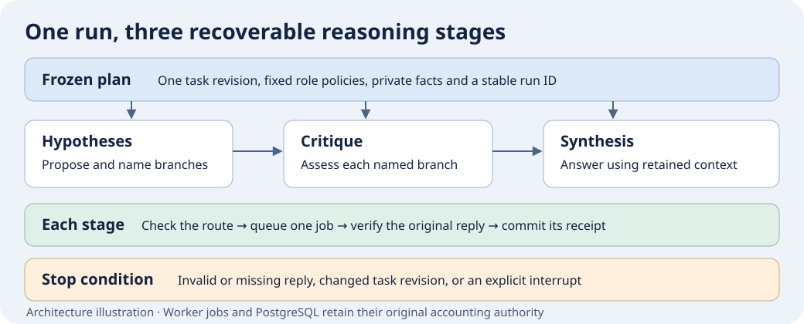

# R7.4-H restartable checked investigations

A Potbot investigation can now use three accepted reasoning routes as a single recoverable run. The controller proposes hypotheses, asks a critic to assess the named branches, then asks the synthesizer for an answer based on that evidence and critique. The existing job worker handles every model request. Reopening a run after the controller stops recovers its existing checks, jobs and accepted stages.



*Architecture illustration of the new terminal workflow. The CLI emits JSON with the current phase and original job IDs. The examples below show the interface directly, so a screenshot or video would repeat the commands.*

## Plan one run

Run a normal Potbot job worker and provision an active task in the authenticated workspace. Prepare an owned, independently accepted compiled reasoning policy for each stage. Existing route, worker, sandbox, Syn, model installation and budget requirements still apply. An installed native model uses directed Syn Context through the same worker.

The private plan is a JSON object with `task`, `evidence`, `constraints` and `stages`. Supply an ordered stage record for `hypothesis_generator`, `critic` and `synthesizer`. Each record contains its role, `policy_id` and an ordinary unfilled workbench request for the same task. Each request leaves the literal system and user prompt fields for the existing compiler. Evidence is a list of JSON records. Constraints are a list of strings. Keep the run UUID and plan together.

```text
potbot reasoning --workspace WORKSPACE_UUID --principal PRINCIPAL_UUID start RUN_UUID --plan plan.json
potbot reasoning --workspace WORKSPACE_UUID --principal PRINCIPAL_UUID follow RUN_UUID
potbot reasoning --workspace WORKSPACE_UUID --principal PRINCIPAL_UUID inspect RUN_UUID
potbot reasoning --workspace WORKSPACE_UUID --principal PRINCIPAL_UUID result RUN_UUID
```

Pass the authenticated workspace and principal IDs before each subcommand as shown. `start` records the plan and task revision. It queues no work. `follow` uses the normal operator setup credential for checks and launches. It advances only this run, and it can stop and resume with the same UUID. `advance` takes one controller step for callers that already have a polling loop. `result` reads the original synthesis after all three roles have passed validation.

## Handoff and interruption

| Stage | Data carried forward |
| --- | --- |
| Hypotheses | Bounded hypotheses assigned deterministic branch IDs. Proposed questions remain model output. |
| Critique | One advisory critique for each frozen branch. Each successor carries the predecessor receipt hashes. |
| Synthesis | Original evidence, named hypotheses and retained critiques. A valid synthesis format still requires independent correctness review. |

Migration 54 records the run, stage index and accepted outcome receipts. The controller reconstructs the next prompt from the exact original predecessor results and compares its facts with the checked decision before launch and adoption. SQL binds each reserved stage decision to the plan and task revision. The ordinary check, launch and dispatch transactions acquire a run fence. Hosted jobs recheck at the final transport admission point. An already authorized effect retains its existing ledger lifecycle.

`potbot reasoning --workspace WORKSPACE_UUID --principal PRINCIPAL_UUID interrupt RUN_UUID --confirm` commits the run fence before requesting cancellation of the linked queue work. After loss, invalid output, a failed check or a changed task contract, the run cannot start the next stage. The current decision remains inspectable. A lost reply retains the original job and its uncertain accounting. Running `follow` again resumes observation of that run.

## Verification boundary

The PostgreSQL acceptance tests exercise normal workbench checks and worker calls with controlled provider responses. They include fresh controller instances between phases, verified predecessor handoff, one charge per confirmed execution, interrupted dispatch, and refusal to advance after reply loss. The foreground CLI is opt-in. The interactive chat investigator's steering and evidence-tool loop still need to migrate onto durable stages. Qualification of the signed native worker over live Syn and protected rollout gates remains open.

The preceding [sealed native worker increment](r7-4-g-native-model-workers.md) documents installation and model accounting.

The [schema-constrained reasoning increment](r7-4-i-structured-reasoning.md) shows how hosted hypothesis and critique stages can opt into strict decoding.
