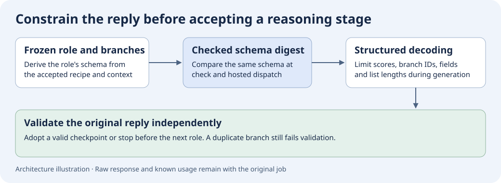

# R7.4-I schema-constrained reasoning stages

A checked hypothesis or critique job can now ask the decoder to follow a bounded role schema. Potbot derives it from the immutable prompt recipe and frozen context. The signed operation check binds the schema digest, and hosted dispatch compares it with the original check before reserving and sending work. Existing prompt variants and their identities are preserved.

*Architecture illustration. The change is in the checked worker protocol and has no new interface to show in a screenshot or video.*

## Configure an accepted route

For `hypothesis_generator` or `critic`, create a new compiled reasoning policy with the recipe variant `model_role_schema_v1` and output contract `json_object_v1`. The new prompt has version `model-aware-reasoning-role-schema-v1`. Use the ordinary owned route, independent acceptance and checked job process from the [restartable investigation guide](r7-4-h-routed-investigations.md). Select an OpenAI model and protocol that support Structured Outputs. The existing plain synthesis recipe remains available for the final answer.

The application owns the schemas. The ordinary job input has no field for a caller-supplied schema. Unsupported providers, native model Cogs and other roles cannot opt into this hosted variant. If a configured backend refuses the request, the execution reports the ordinary provider outcome and does not quietly fall back to JSON mode or issue a second request. [OpenAI Structured Outputs](https://developers.openai.com/api/docs/guides/structured-outputs)

| Role | Decoder constraints | Independent validation |
| --- | --- | --- |
| Hypothesis generator | One to three hypotheses. Up to three assumptions and questions per hypothesis. Questions use one of the known channels. | Exact fields, bounded nonempty text, and valid channel selection. The model's questions are proposals. |
| Critic | The exact number of evaluations. Only frozen branch IDs. Scores use the integers 0 through 4 and known recommendations. | Every branch must appear exactly once. Text and list bounds still apply. Scores remain advisory. |

The hosted worker includes the exact schema in the request fingerprint and in the disclosure and conservative input budget checks. Existing request, task, route, credential and cancellation checks still apply. A confirmed request retains reported usage even if its answer cannot advance the investigation. A valid schema can constrain the shape of a reply. Correctness still depends on the evidence and answer.

## Verification

The PostgreSQL tests verify the exact schema sent from the original check, a normally settled job and refusal to consume a duplicate-branch response that passes JSON Schema. Six representative prompt identities were read from the previous source and verified unchanged after the change. Provider wire fixtures cover both OpenAI protocols.

A local Qwen3.5 2B test used the existing model and a test adapter that passed the exact hosted wire schema to Ollama. In three isolated probes, adding the schema to the frozen prompts fixed all three earlier role-output refusals. Four full investigations used the same task inputs as the previous run. All four reached synthesis, compared with one before. Manual grading found three correct answers. The USB-drive answer recommended a model whose capacity was below the minimum, despite mentioning the expected values elsewhere. The keyword check therefore gave a false positive. The 12 requests settled once each, with 15,196 reported tokens and no outstanding holds. [Ollama Structured Outputs](https://docs.ollama.com/capabilities/structured-outputs)

These small local cases exercise the checked path and actual decoding through an adapter. Live OpenAI compatibility and the signed native worker over directed Syn retain separate qualification gates.

The [verified synthesis follow-up](r7-4-j-verified-synthesis.md) adds independent checks for final numeric choices and counts.
