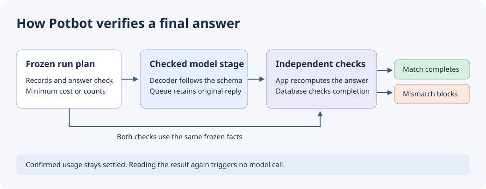

# R7.4-J verified synthesis

Potbot can now recompute the final answer to two kinds of investigation from frozen facts. A decoder schema bounds the reply, and the original reply must agree with the records before the run can complete.



*Architecture illustration. The change uses the existing command line and worker. The verified examples below summarize their retained output.*

## Freeze the answer check

Configure the accepted `synthesizer` recipe with `model_role_schema_v1` and `json_object_v1`. Provide an `answer_check` in the immutable run plan. Hypothesis and critique retain their existing contracts. Potbot derives the final schema from the plan and binds its digest in the same checked queue as the earlier stages. Follow the [structured reasoning guide](r7-4-i-structured-reasoning.md) for provider support and route acceptance.

For a minimum-cost choice, specify one capacity unit and one cost unit throughout the data. For example, these capacities are in GB and costs are in whole pounds.

```json
{
  "kind": "minimum_cost",
  "minimum_capacity": 32,
  "records": [
    {"id": "Blue", "capacity": 16, "cost": 5},
    {"id": "Green", "capacity": 32, "cost": 7},
    {"id": "Red", "capacity": 64, "cost": 9}
  ]
}
```

The expected reply is `{"record_id":"Green","capacity":32,"cost":7}`. The selected record must match its original values, meet the threshold and have the lowest eligible cost. Any exact record tied at that cost is accepted.

For counts, use `{"kind":"counts","labels":["ready","held","blocked"],"values":["ready","held","ready","blocked","ready"]}`. The expected reply is `{"counts":{"ready":3,"held":1,"blocked":1}}`. Every declared label is required, including labels with zero occurrences.

## Completion and recovery

The result reader parses the retained original reply as a literal JSON object with unique keys and integer values. It independently verifies the values against the compiled frozen check. A separate PostgreSQL completion check verifies the original job reply, the saved result and the same facts. On a match, the result exposes the verified parsed answer and `semantic_correctness` equal to `verified_against_frozen_records`. If a reply has the right shape but disagrees with the evidence, the run blocks with `answer_check_failed`. The job and its usage settlement remain available, and repeated advancement does not make another provider call.

These checks cover the numeric selection and count contracts. The quality of the frozen inputs remains the responsibility of whoever prepares the investigation. Existing prose and structured hypothesis and critique recipes retain their behavior.

## Verification

| Three-stage Qwen3.5 2B workflow | Verified final result | Calls | Reported tokens |
| --- | --- | ---: | ---: |
| USB choice | Green at 32 GB for £7 | 3 | 4,129 |
| Status counts | Three ready, one held, one blocked | 3 | 3,689 |

The local run used an Ollama adapter that passed the exact provider-shaped schema through Potbot's checked queue, with disposable PostgreSQL. All six calls settled, with no held reservations and no replay on repeated result reads or advancement. A first attempt exceeded the test's 60-second hosted deadline and was fenced. The two completed cases used 120-second deadlines in a fresh fixture. Separate PostgreSQL tests show that a wrong answer cannot finish the run even through a direct checkpoint write. Both supported migration 54 lineages upgraded to 55 with their prior checksums and hosted evidence intact.

## Native image qualification

The sandbox system image workflow accepts a manual `native_inference` input. It builds the `native-inference-v1` variant for each architecture using a separate tag bound to the source commit. A dispatch from a branch builds for inspection. Main can sign and publish through the existing release mechanism. Ordinary runs continue using `system-v1`.

R7.4 rollout still requires the signed native image to pass the installed TASKSTATS launcher over directed Syn, including reply loss and collector-loss fencing. The quality decision also requires an independently reviewed protected holdout and a bounded canary with a rollback procedure. The local results above cover two cases through a test adapter.
