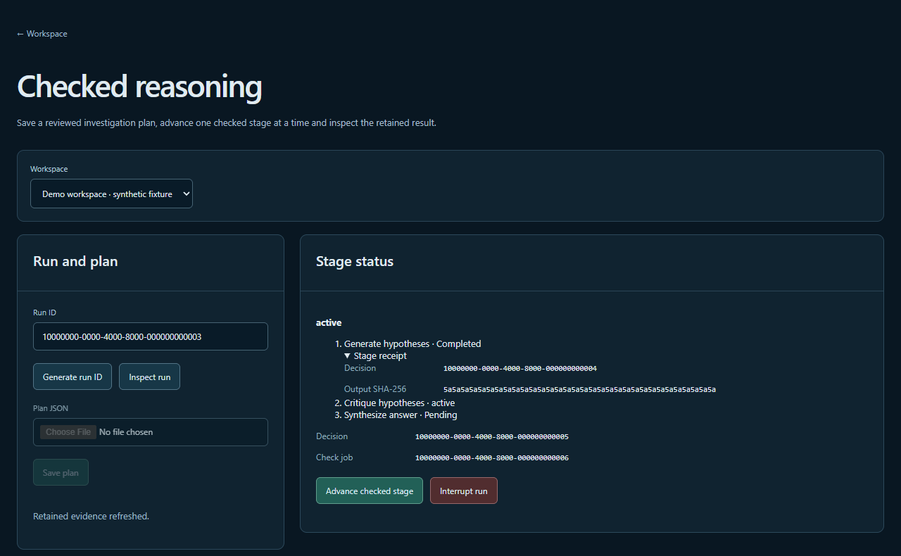

# R7.4-K checked reasoning workbench

An operator can open a durable investigation from the Research console, review its current stage and advance it explicitly. A run also accepts selected excerpts from already completed Potbot research. The workbench uses the existing route checks, task budget, job queue and worker transport.



*The implemented workbench with synthetic run data. The screenshot shows the interface in a local test fixture.*

## Open and control a run

Use **Research → Checked reasoning** with the normal authenticated operator session and loopback Potbot controller. Select your existing [checked investigation plan](r7-4-h-routed-investigations.md), keep the displayed run UUID and explicitly start the run. The controller freezes the plan and its task revision at start. This step makes no model request. An existing run can be reopened by UUID without uploading the plan again.

| Control | Effect |
| --- | --- |
| Inspect | Read the retained stage, job identities and outcome digests. |
| Advance | Take one queue or checkpoint step for the displayed stage. The existing operator setup credential authorizes the step on the controller. |
| Interrupt | Commit the run fence and request cancellation for any linked check or job. A previously authorized effect retains its ordinary outcome and accounting. |
| Read final answer | Retrieve the original synthesis after the run has completed. Typed [verified synthesis](r7-4-j-verified-synthesis.md) carries its own correctness marker. |

A late retry naming an earlier stage cannot start its successor. After an uncertain command reply, inspect the original UUID before taking another action. A provider reply lost after dispatch preserves the original indeterminate job and reservation. The three stages still run through the existing sandbox or hosted worker. The operator console is local to the controller. The installed worker continues to use directed Syn where required.

## Include a settled research citation

Add `evidence_citations` to the usual plan to select one to four exact excerpts. Use the existing research citation picker and its immutable repository-state ID. Use the source's exact T05 run and source IDs, UTF-8 byte range and quote digest.

```json
{
  "evidence_citations": {
    "repository_state_id": "00000000-0000-0000-0000-000000000001",
    "allow_hosted_disclosure": true,
    "citations": [
      {
        "runId": "00000000-0000-0000-0000-000000000002",
        "sourceId": "00000000-0000-0000-0000-000000000003",
        "startByte": 15,
        "endByte": 27,
        "quoteSha256": "0000000000000000000000000000000000000000000000000000000000000000"
      }
    ]
  }
}
```

Set `allow_hosted_disclosure` to true only when the operator approves sending the selected excerpts to the configured hosted model. False is available for plans that use native model operations throughout. The existing request disclosure and budget checks still apply.

Potbot verifies the original retained citation and checks the current task contract, repository snapshot, semantic pin, information-need revision and applicable publication freshness. The run freezes at most 1,024 UTF-8 bytes per excerpt as untrusted data with content digests. The prompt receives the selected excerpts and opaque provenance digests. Exact restart or start retry reuses the frozen data without fetching or reopening the source. To revise the plan or add evidence after freezing it, start a separate run with a new UUID. The compatibility chat investigator retains its existing prompt inbox.

## Verification

Disposable PostgreSQL tests drive all three roles through the operator adapter, restart, reject a stale advance, and recover the original settled synthesis. Negative tests fence cancellation before provider dispatch and preserve an indeterminate hold after reply loss. A separate research fixture settles a synthetic T05 retrieval, admits its exact excerpt to the compiled prompt, and refuses foreign, altered and stale citations. The frontend tests exercise request and response bounds, operator scope and single-send behavior. Hosted replies in these checks are fixtures.

Full rollout still needs an independently reviewed protected comparison, controlled canary and rollback, and live qualification of a signed native candidate through installed TASKSTATS and directed Syn.

[Stage guidance](r7-4-l-stage-guidance.md) lets an operator add explicit constraints before allocating a successor stage.
