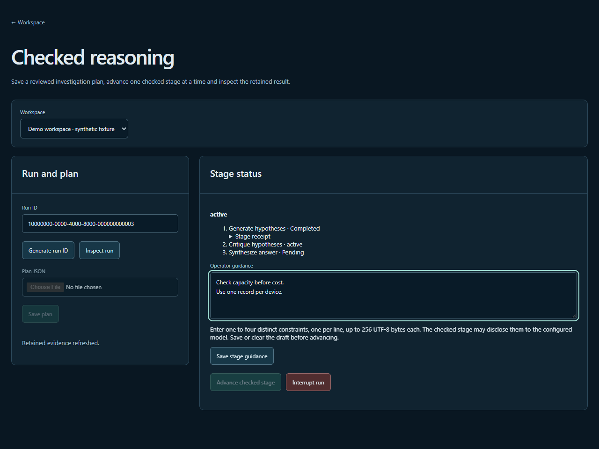

# R7.4-L guidance at a checked stage

An operator can add guidance to a critique or synthesis after reviewing the preceding checkpoint and before the next stage is allocated. The [checked reasoning workbench](r7-4-k-checked-reasoning-workbench.md) saves the guidance separately from the original plan and shows the retained values.

*The implemented workbench rendered in an isolated browser fixture with a synthetic investigation.*

## Guide the current stage

Inspect an active run before starting the next check. At an unallocated critique or synthesis, enter one constraint per line and select **Save stage guidance**. The workbench accepts one to four distinct constraints of up to 256 UTF-8 bytes each. Confirm that the configured model may receive that guidance. Reading a run and saving guidance make no inference request. The separate **Advance checked stage** control still authorizes one stage step through the ordinary worker and task budget.

The committed constraints belong to that run and stage. A repeat of the exact save returns retained status. A change after allocation would alter the checked prompt, so Potbot refuses it. Keep any guidance revision for a separate investigation. The original plan, preceding checkpoints and settled usage remain available.

If an advance races with a guidance save, the database requires the compiled prompt to match the constraints retained for that stage. A stale compilation rolls back. The controller returns the current stage for inspection. A fresh explicit advance uses the saved guidance. This keeps a lost response or simultaneous command from launching an unguided job.

## Evidence

The PostgreSQL test saved guidance after the controller had read the next stage and before it allocated the check. It observed an empty queue after the stale attempt, verified the exact operator constraints in the next compiled prompt and provider request, and observed one settled usage record for each completed stage. A direct late insert using the run owner's restricted database account was refused.

Both supported migration histories upgraded from revision 55 to 56 with every previous checksum and the original hosted outcome, sharing and review records intact. The browser fixture verified an explicitly confirmed save, loss of its reply, and recovery by inspection. The compatibility chat inbox and managed installed runtime retain their separate qualification.
