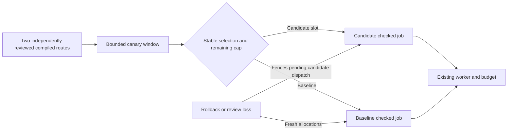

# Bounded model canary and rollback

An operator can open a time-limited canary for a candidate with its own frozen prompt recipe and independent acceptance. The rollout pairs two existing checked route policies. Both must belong to the same workspace and operator, share the same role, task kind and evaluation plan, and name the same independent reviewer. The paired policy must match the original manifest’s exact candidate target. The reviewer must inspect the evaluation and running deployment evidence before accepting either route.

## Start and stop a window

Use `ModelRouteCanaries.start` with a fresh canary UUID, the two policy UUIDs, the sampling percentage in basis points, the absolute candidate allocation cap and a deadline. Sampling covers up to 10% of the hash space. The absolute cap is at most 100 candidate allocations and the deadline is at most one hour after creation. Concurrent allocations acquire the same route lock before counting slots. Each admitted candidate consumes its slot permanently, including attempts that fail before dispatch or finish with an uncertain result.

Call `ModelRouteCanaries.allocate` with a stable request key, both request templates and the shared task facts. Potbot compiles the two templates locally using their frozen recipes. The database retains one assignment and one route decision in the same transaction. Pass that decision to the existing signed operation check, then launch with the selected operation and returned request. Reusing the key after a lost reply returns its original selection and job identity. Changed inputs need a fresh key and explicit authorization. The candidate policy rejects new decisions made outside its window.

Use `ModelRouteCanaries.rollback` to stop the window. Rollback is terminal. The same lock orders it with the candidate’s possible-dispatch marker. Candidate work waiting to dispatch is fenced. Work already marked as possibly dispatched keeps its original state and budget reservation. The same request key still recovers that original work. Fresh allocations return to the baseline and require its current independent acceptance and normal worker checks. Expiry or superseding either review also closes candidate admission. Candidate promotion requires a separate rollout decision.

The diagram describes the controller and database contract. The acceptance fixture uses disposable PostgreSQL and a provider-shaped transport to measure exact call counts, including after a lost reply. This headless contract has no interface to capture. Installed worker and independently reviewed holdout evidence retain their own acceptance gates.
