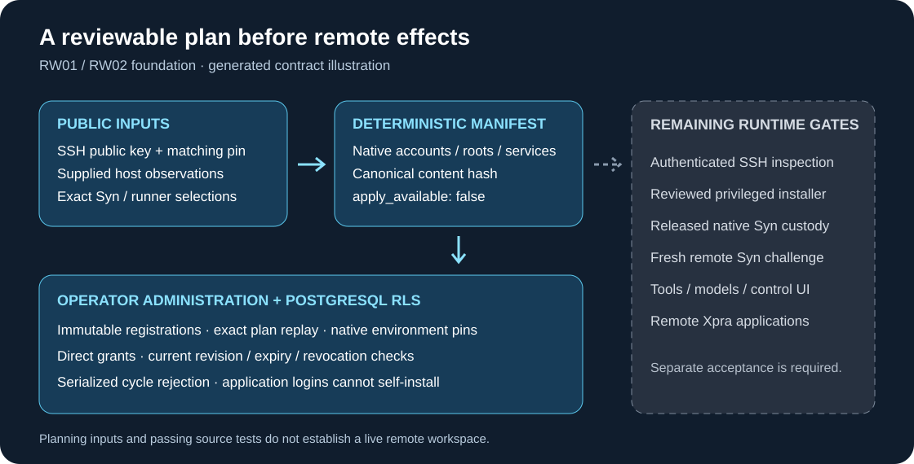

# Native remote workspace foundation (RW01 / RW02 planning slice)

This increment starts the remote workspace plan with immutable native deployment
records, direct workspace-control grants and a deterministic installation plan.
The CLI can inspect its current host and review supplied public facts. It cannot
connect to or install a remote machine.



*Generated contract illustration. The blue path is implemented source behaviour;
the grey path requires later host and transport acceptance. This is not a running
remote workspace screenshot.*

## Try the non-mutating commands

Use an already installed core environment; no database, models or desktop extras
are required for these commands:

```bash
python -m potbot remote-workspace --help
python -m potbot remote-workspace probe
python -m potbot remote-workspace plan --input examples/remote-workspaces/planning-fixture.json
```

Run `probe` **on the host being inspected**. It reports OS, architecture, Python,
boot identity, systemd availability and free installation storage. It does not
inspect GPU devices or native Syn custody. Its timestamp and PID identify the
observation, not remote route authentication.

The example is an entirely synthetic fixture: its DNS name, public key, UUIDs,
release versions and hashes must never be used as a real deployment selection.
`plan` accepts at most 64 KiB of UTF-8 JSON, rejects duplicate/unknown input
fields and returns the manifest plus its canonical SHA-256. Identical inputs
produce identical manifests, independent of release-list ordering.

The manifest lists desired accounts, controller custody directory, native
workspace root, versioned environments and services for operator review. It
requires one explicit minimal Potbot runner pin and one Syn release pin. These
are selection records; signature and installed-byte verification happen in a
later installer. The opaque SSH credential reference is node-bound; the CLI
does not resolve it or accept private key bytes. The initial public-key parser
supports canonical Ed25519 keys without comments; other algorithms and host CAs
need their own adapter.

Models and framework caches belong beneath the remote project's `models/`,
which its future installer must add to that project's `.gitignore`. The 1 GiB
default installation floor excludes model weights and workload reservations.

Compatible supplied host facts still return `apply_available: false`, all
capabilities unavailable and explicit remaining gates. Ubuntu 24.04 x86-64,
Python 3.12 or later, systemd, boot identity and adequate free storage are the
initial compatibility checks. Imported facts are labelled `supplied_host_facts`;
they do not establish the selected machine's identity or freshness.

## Records and operator services

Migration **50**, allocated on `codex/potbot-remote-workspaces` from main commit
`f13512cb9944b7e09e792bad27bb30746bfc5834`, adds:

| Record | Contract |
| --- | --- |
| `remote_workspace_owners` | Explicit operator-installed owner; membership alone cannot self-appoint |
| `remote_nodes` | Immutable public SSH registration, node-bound credential reference and generation; state remains `registered` |
| `native_workspace_deployments` | Revisioned `base_os` environment and account/root pins; qualification remains `unqualified` |
| `remote_provisioning_attempts` | Exact reviewed manifest and idempotency key; state remains `planned` |
| `workspace_control_grant_revisions` | Direct source/principal/target permissions, expiry, revision, revocation generation and terminal revocation |

Both existing migration lineages retain revisions 1–49 unchanged. Existing
`workspace_sandboxes.isolation_requirement='required'` rows are not rewritten.
Native registration rejects a workspace already registered as a sandbox. The
existing executor remains responsible for its current sandbox checks.

The functions in `potbot.controller.remote_workspaces` use an explicit
administrative transaction from `potbot.persistence.database.admin_connection`.
They reuse the established operator grant pattern. Ordinary application roles
retain existing workspace RLS and cannot insert, update, delete or truncate the
new records. Do not expose an administrative DSN through a request adapter.
Owner-authorized UI/API/Cog write adapters remain later work.

Node registration and reviewed-plan recording replay the original identity for
identical content. A changed pin or a reused idempotency key with different
manifest bytes fails. Deployment and control-grant revisions are contiguous and
append-only. A revoked grant cannot be reactivated; reauthorization needs a new
owner-issued grant ID.

Control graph changes serialize with a schema-scoped advisory transaction lock.
The service requires `READ COMMITTED`, then reads current edges in a separate
SQL command after obtaining the lock. This uses PostgreSQL's documented
[per-command snapshots](https://www.postgresql.org/docs/17/transaction-iso.html)
and [transaction advisory locks](https://www.postgresql.org/docs/17/explicit-locking.html#ADVISORY-LOCKS).
Two concurrent inverse grants cannot both commit. The operator service sees the
complete graph; an application login with only a workspace view cannot issue it.

`current_control_grant` loads the latest target-owned revision. Its pure
`authorize` method checks the exact authenticated source workspace/principal,
target, permission, revision, revocation generation and expiry. A→B plus B→C
does not authorize A→C. A caller-provided dataclass or signed old copy supplies
no authority. No execution adapter is enabled by this method.

## Verification and next slice

Run focused portable checks through the maintained Windows wrapper or equivalent
Linux environment:

```powershell
pwsh ./scripts/Invoke-Tests.ps1 tests/unit/test_remote_workspaces.py -q
```

The `Native remote workspace planning and authority` workflow starts an isolated
PostgreSQL/pgvector fixture, executes the new migration/RLS/revocation/concurrency
cases and existing database/context ACL regressions, and rejects skipped SQL
acceptance. Its disposable database container is a test dependency; no remote
workspace is provisioned in it. Read the actual run and retained JUnit evidence
before treating this database gate as passed.

RW01 remains in progress for versioned dispatch/application records and live
authenticated service adapters. RW02 next needs strict SSH inspection with an
independently verified server key and existing credential reference, followed by
the fixed privileged helper and interruption/reconciliation checkpoints. The
reviewed manifest is the input to that work, not an installer approval.

RW03–RW09 still require released native Syn host/custody and remote transport,
durable effect recovery, native tools/models, control UI, Xpra import and a
physically distinct two-machine demonstration. This slice makes no claim of
remote installation, network ingress, inference or GUI qualification.

The CLI output and source tests are the useful evidence at this stage. There is
no implemented remote UI to screenshot or record. Capture real screenshots and
a captioned demonstration video when those later behaviours exist.
