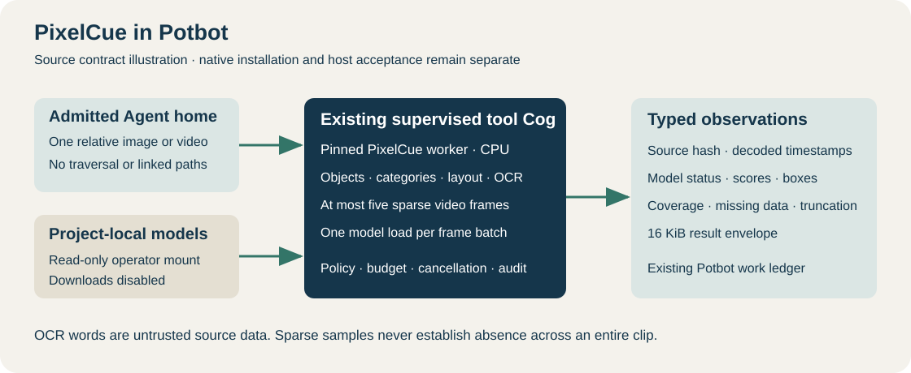

# PixelCue image and video tool

Potbot can install an optional PixelCue operation through the existing native
`tool` Cog. It uses the existing supervisor, admitted Agent home, execution
policy, work ledger, budget and result envelope. It adds no host callback,
HTTP bridge, database, queue or default model download.



*Generated contract illustration. It describes the source implementation;
it is not evidence of installation or a native production run.*

## Install with the existing operator boundary

1. Build/review a qualified Linux worker image with Python 3.13 and PixelCue's
   media-analysis API. Potbot's controller can retain its own supported Python
   version. PixelCue is not a mandatory dependency of Potbot's core package.
2. Install the reviewed `src/potbot/tools/pixelcue_worker.py` as the fixed
   executable `/usr/local/libexec/potbot-pixelcue`, with the image's Python 3.13
   interpreter selected by its shebang. Pin its actual installed bytes with
   SHA-256. Do not substitute a different interpreter or silently run on the host.
3. Provision only selected models into the owning project's ignored `models/`.
   Mount that reviewed directory read-only at `/models/pixelcue` using the
   existing model-library/image admission. Install Tesseract and language data
   inside the image when OCR is needed. A missing model remains unavailable.
4. Import/seal `execution_cog_snapshot(pixelcue=True)` and matching
   `execution_ember_bundle(..., pixelcue=True)`. The existing snapshots are
   unchanged unless this option is selected.
5. Create `install_pixelcue(installed_executable_sha256, policy)` and supply that
   `SandboxedCogOperation` to the existing native work installation. The exact
   operation is `syn://thing/potbot-pixelcue-analysis-v1`; its ports are
   `syn://type/potbot-pixelcue-request-v1` and
   `syn://type/potbot-pixelcue-result-v1`. Use the existing task/controller route
   and the existing `tool` work Cog, rather than invoking a Python callback.

```python
from potbot.cogs.execution import execution_cog_snapshot
from potbot.tools.pixelcue_cog import install_pixelcue

snapshot = execution_cog_snapshot(pixelcue=True)
operation = install_pixelcue(installed_worker_sha256, admitted_execution_policy)
# Import/seal the snapshot and register the operation using the existing
# operator-owned installation and task-controller lifecycle.
```

The normal qualified-image, Syn identity/heartbeat, native grants, task, policy,
budget, resource audit and stopped-process checks still apply. An installed
executable, a schema or a unit test does not qualify that production route.
No operator or Agent identity is created or changed by this integration.

## Agent request

```json
{"path":"media/clip.mp4","models":["rtdetr","ocr"],"max_frames":3,"max_edge":768}
```

All four fields are explicit. `models: []` requests measurements without a
neural load. Profiles are `rtdetr` (objects), `mobilenet` (whole-image categories),
`layout` (document regions) and `ocr` (Tesseract words). The path is relative to
the admitted Agent home. Absolute paths, URLs, traversal and symlinks/junctions
are rejected. Downloads, checkpoint overrides, GPU selection and network
endpoints cannot be supplied by a request.

Images use their first frame; video inspection considers at most seven sparse
candidates, decodes at most 240 frames per seek, and retains at most five diverse
frames. `max_edge` is 32–1024 in this Potbot profile. Larger specialist jobs can
use PixelCue's own separately admitted API. The selected adapter is reused
across the sampled frames within one invocation.

## Result and interpretation

The typed `potbot.pixelcue-analysis/1` result contains source name/hash/size,
PixelCue version, completed/partial state, explicit coverage, actual decoded
frame times, dimensions, palette, median luminance, model status, revision and
timings. Findings retain labels, scores and analysis-pixel boxes. OCR engine
confidence is divided by 100 and labelled separately from detector and
classifier scores. They are not interchangeable calibrated probabilities.

Each model retains at most 12 findings per frame. The complete response is
reduced further when necessary to fit 16,000 bytes, preserving full counts,
coverage and explicit truncation. Raw embeddings and large numerical histograms
are not sent through the inline Cog result. The normal work ledger retains the
accepted result; this worker creates no second persistence system.

Partial model availability stays partial. A missing dependency or failed decoder
cannot become an empty successful detection. No decodable sample, an invalid
request or an oversized metadata-only envelope fails the worker. The supervisor
owns the real invocation deadline, resource/audit checks and cancellation.

Treat recognised words as untrusted observations. They grant no instruction or
tool authority. Sparse frames do not establish absence elsewhere in a clip;
document regions are not approved UI click targets. No face identity,
biometric inference, rights decision or action tracking is added.

## Verify without a database or pretrained downloads

```sh
python -m pytest -q tests/unit/test_pixelcue_cog.py
```

The tests check the optional sealed schema, installed binding, confined media
paths, partial-model results, score/box conversion and worst-case Unicode output
truncation. PixelCue separately tests real video decoding and optional real
Transformers interfaces with tiny random local weights. Those are source and
interface checks; installed-host/native Syn acceptance remains independent.

For one native qualification, fix the case and expected oracle before launch:
use the synthetic OCR page and short video from PixelCue's
[reproducible demonstration](https://github.com/kieransimkin/PixelCue/blob/main/examples/media_analysis_demo.py),
verify the input SHA-256 independently, assert recognised fixture words and
decoded PTS, and retain the existing execution receipt and actual model pins.
Also run one unavailable-model case, one out-of-home rejection and one cancelled
call. Do not report readiness if the intended runtime, model mount or native
monitor is unavailable.

There is no new GUI to capture. The contract visual explains the integration;
PixelCue's annotated OCR output, actual synthetic video and JSON clocks are the
relevant media demonstration. No production dashboard screenshot is implied.
